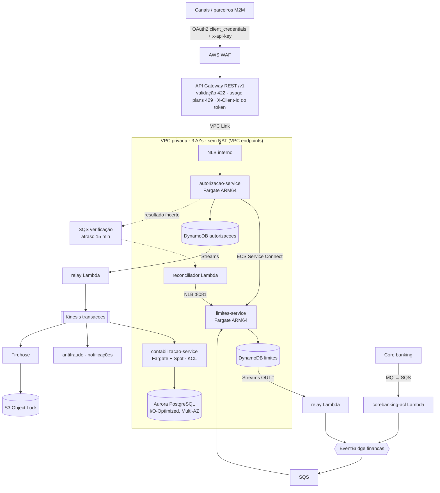
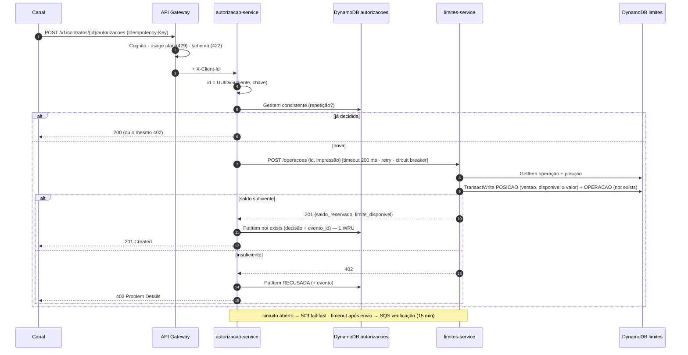

# Arquitetura de solução

**NFRs** (o PDF define só o pico; o restante é premissa declarada): 5.000 TPS de pico, ~1.500 TPS de média,
p99 < 100 ms na borda, 99,95% de disponibilidade, RPO ≈ 0 e RTO < 15 min (falha de AZ), região **sa-east-1**.

## Containers (C4 nível 2)

## Fluxo da autorização (caminho síncrono)

Orçamento de latência p99 (alvo 100 ms): WAF + API Gateway ~15 ms · autorização ~5 ms · GetItem ~5 ms ·
chamada ao Limites ~5 ms · 2 GetItem + TransactWrite ~20 ms · PutItem ~8 ms · folga ~40 ms.

## Compute

| Componente | Runtime | Motivo |
|---|---|---|
| autorizacao, limites | **Fargate ARM64** | caminho síncrono a 5k TPS: sem cold start, p99 previsível, circuit breaker com estado estável, Service Connect |
| contabilizacao | **Fargate (base on-demand + Spot)** | volume constante = volume da autorização; KCL; pool fixo no Aurora sem RDS Proxy; Spot porque é idempotente e tolera interrupção |
| relay, reconciliador, ACL, stubs | **Lambda Java 21 ARM64 + SnapStart** | gatilho nativo (Streams, SQS, Kinesis) com falha parcial de lote; escala a zero; custo de dezenas de dólares |
| EKS | descartado | operação de cluster sem benefício para 3 serviços |
| Lambda no síncrono | avaliado e descartado | cold start na cauda, SnapStart incompatível com provisioned concurrency, circuit breaker por ambiente, custo 4–6× (ADR 022) |
| Lambda Managed Instances | avaliado e descartado | a AWS o indica para carga sem picos inesperados; dobra capacidade em ~5 min (ADR 023) |

Escala: target tracking de CPU (60%, scale-out em 30 s), ação agendada no início do mês (mínimo ×2 do dia 1 ao 5)
e, antes de picos planejados, pré-aquecimento do DynamoDB (warm throughput) e resharding do Kinesis.

## Well-Architected: onde cada pilar aparece

| Pilar | Implementado em |
|---|---|
| **Excelência Operacional** | Terraform por módulo; deploy ECS com circuit breaker e rollback; alarmes de p99, 5xx, idade do outbox, idade do Kinesis, throttling e DLQ (`modulos/observabilidade`); ADOT/X-Ray; tags de custo |
| **Segurança** | Cognito client_credentials + API key + WAF gerenciado; VPC privada sem NAT; IAM por task/função com recursos específicos; CMK com rotação; Secrets Manager (senha do Aurora); S3 Object Lock COMPLIANCE; ECR com scan e tags imutáveis |
| **Confiabilidade** | 3 AZs; escrita condicional + idempotência ponta a ponta; outbox sem dual-write; DLQ/quarentena em todo consumidor; replay (Kinesis 7 d, archive 90 d); PITR; circuit breaker + retry com jitter; reconciliação de incertos |
| **Eficiência de Performance** | DynamoDB key-value; 2 itens por transação; virtual threads (Java 21); pool HTTP do SDK; Kinesis por partition key; SnapStart |
| **Otimização de Custos** | id determinístico (−3 WRU/aut.); TTL 35 d; PROVISIONED + auto scaling; relay Lambda em vez de Pipes; Kinesis em vez de EventBridge no alto volume; Aurora I/O-Optimized; Spot; filtros de ESM; gateway endpoints gratuitos ([custos.md](custos.md)) |
| **Sustentabilidade** | Graviton em todo compute; escala a zero nas Lambdas; dados frios em Glacier IR; TTL elimina dado sem uso |

## DR

Multi-AZ ativo em sa-east-1. DR regional **ativo-passivo**: Global Tables MRSC não está disponível em
sa-east-1 (doc AWS) e MREC é last-writer-wins — inaceitável para limite em ativo-ativo. Região de DR a definir
com Compliance (residência de dados).
