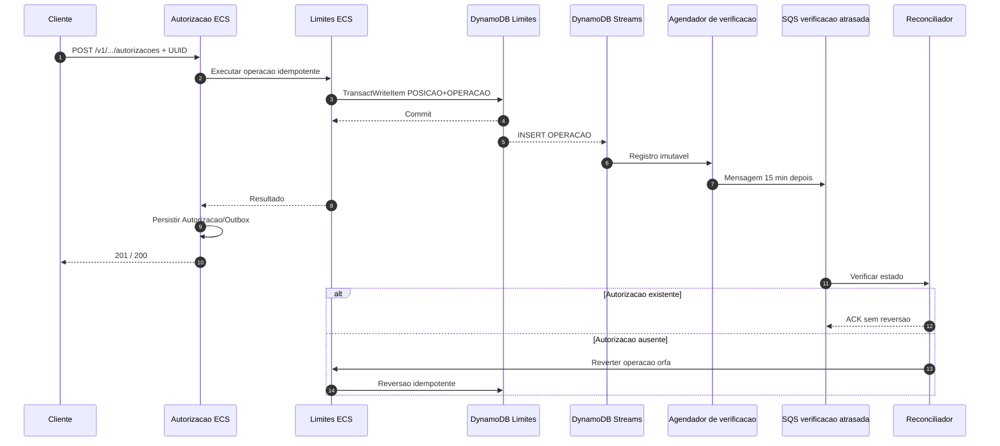
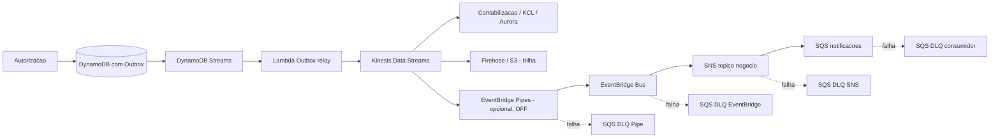
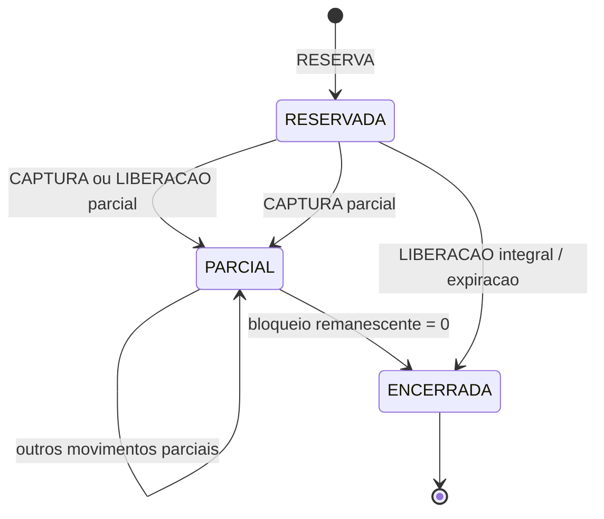

# Diagramas complementares — arquitetura revisada em 22/10/2026

> Os arquivos PNG/SVG entregues no ZIP original continuam preservados como referência visual,
> mas **não incluem** as correções C01/C03/C05/C06/C04 optional da auditoria.
> Os diagramas abaixo refletem a **topologia proposta no código**; não evidenciam execução AWS.

## 1. Fluxo de autorização e compensação

O agendamento SQS e a verificação são **at-least-once**. Se Streams/Lambda/SQS falharem,
a conciliação diária tenta detectar lacunas. O prazo 15 min **não é SLA garantido**.

## 2. Eventos e topologia de fan-out (opcional)

A ponte Pipes/EventBridge e SNS/SQS de notificações foi **implementada em Terraform com flag OFF**.
Habilitar somente após revisar limites, IAM/KMS, transformação CloudEvents e custo incremental.

## 3. Ciclo AmountBlock e recuperação

A expiração depende do EventBridge Scheduler em AWS e duas DLQs diferentes (entrega Scheduler e processamento SQS).
No Compose local a entrega é **simulada diretamente por SQS**, não valida o Scheduler gerenciado.

O republicador normal funciona enquanto o item ainda existe no DynamoDB; após TTL,
o runbook de **replay supervisionado da trilha S3** é obrigatório. Não assumir recuperação automática do evento expirado.
