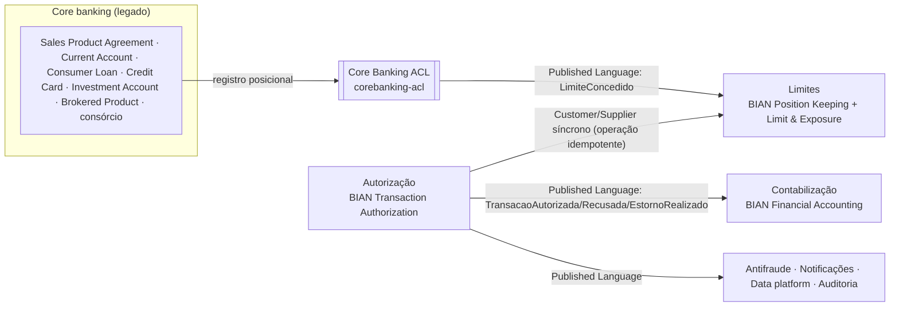

# Domínio: BIAN → DDD → código

A hierarquia BIAN foi validada na matriz oficial **v12.0 e v13.0** (bian.org) e nas Semantic APIs oficiais
(`github.com/bian-official/public`). Os SDs usados ocupam o mesmo lugar nas duas versões. A torre completa,
com o motivo de cada SD usado ou descartado, está em `../../docs/diagramas/piramide-bian-ddd.svg` e
`../../docs/MEMORIA.md` §3.

## Bounded contexts e context map

## Linguagem ubíqua (PT-BR) ↔ BIAN ↔ classe

| Termo do negócio | BIAN oficial | Classe |
|---|---|---|
| Autorização | CR *Interactive Transaction Assessment* (Transaction Authorization) | `autorizacao.domain.Autorizacao` |
| Avaliar transação | Action Term *Evaluate* | `AutorizarTransacao` / `AutorizarTransacaoService` |
| Posição do contrato (limite, disponível) | CR *Financial Position Log* (Position Keeping): *Position Limit Value*, *Amount Block* | `limites.domain.Posicao` |
| Operação (débito, reserva, crédito, estorno) | BQ *Financial Transaction Capture* | `limites.domain.Operacao` |
| Aplicar operação | Action Terms *Control* / *Capture* | `AplicarOperacaoService` |
| Registro contábil | CR *Financial Booking Log* (Financial Accounting) | `contabilizacao.domain.RegistroContabil` |
| Lançamento (partida dobrada) | BQ *Ledger Posting* (*Posting Direction*, *credit/debit pair*) | `contabilizacao.domain.Lancamento` |
| Contrato do legado | SD *Sales Product Agreement* (via ACL) | `acl.RegistroDeContratoLegado` |
| Dinheiro | — (shared kernel) | `kernel.Dinheiro` |

## Agregados e invariantes

| Agregado | Invariantes | Onde é garantida |
|---|---|---|
| `Autorizacao` | só APROVADA/ESTORNADA_PARCIALMENTE de DEBITO/RESERVA aceita estorno; Σ estornos ≤ valor aprovado; mesma Idempotency-Key nunca com outro conteúdo | `Autorizacao.validarEstorno/comEstorno/garantirMesmaRequisicao` + versão otimista no repositório |
| `Posicao` | consumo só se `disponivel ≥ valor`; devolução ≤ utilizado; limite do legado só com `versaoOrigem` mais nova | `Posicao.aplicar/comNovoLimite` + condição `versao` e `disponivel >= :valor` na escrita |
| `Operacao` | idempotente por id; revertida nunca é ressuscitada; repetição só dentro da janela (10 min) | `Operacao.garantirRepeticaoValida` |
| `RegistroContabil` | Σ devedor = Σ credor; imutável | construtor do record + trigger `DEFERRABLE` no Postgres |

## Padrões táticos

| Padrão | Uso | Justificativa |
|---|---|---|
| **Repository** | sim: `AutorizacaoRepository`, `PosicaoRepository`, `RegistroContabilRepository` | o domínio não conhece DynamoDB/JDBC; fakes em memória com o **mesmo contrato** nos testes (LSP) |
| **Domain Events** | sim: `FatoDeAutorizacao`, `EventoDeLimites` | gerados pelo agregado; traduzidos para CloudEvents no adapter; publicados via outbox (sem dual-write) |
| **CQRS** | só na leitura analítica: eventos → S3/Athena (data platform) e consulta de posição separada | o caminho de escrita é key-value e não precisa de modelos separados; CQRS completo seria custo sem benefício |
| **Shared Kernel** | mínimo: `Dinheiro` | evita divergência de arredondamento entre contextos; pequeno e estável |
| **Published Language** | CloudEvents v1 + JSON Schema | contrato público versionado, independente das tabelas |
| **Anti-Corruption Layer** | `corebanking-acl` | o layout posicional do legado não vaza para os contextos |

## SOLID: onde cada princípio aparece

| Princípio | Exemplo no código |
|---|---|
| **S**RP | `AutorizacaoController` só traduz HTTP; `ProblemDetailsHandler` só mapeia erro → status; `TradutorDeContratoLegado` só traduz o legado |
| **O**CP | `RegraDeOperacao` (Strategy) por `tipo_operacao`: novo tipo = nova regra, o caso de uso não muda; `ExtratorDeEventos`/`Destino` no relay |
| **L**SP | `Fakes.AutorizacoesEmMemoria` e `PosicoesEmMemoria` respeitam a semântica condicional dos repositórios DynamoDB; os testes de concorrência valem para ambos |
| **I**SP | ports pequenos: `OperacaoDeLimitePort` (uma operação), `VerificacaoPosteriorPort`, `Quarentena`, `ConsultaDeAutorizacoes`/`ReversaoNoLimite` |
| **D**IP | `domain` e `application` dependem só de ports; Spring, AWS SDK, Resilience4j e JDBC ficam em `adapters`/`config` — verificado por `ArquiteturaTest` (ArchUnit) |

## Semântica de `tipo_operacao` (ADR 021)

| Tipo | Efeito no limite | Evento | Contabilização |
|---|---|---|---|
| DEBITO | consome (`disponivel −= valor`) | TransacaoAutorizada | D clientes a receber / C obrigações com estabelecimentos |
| RESERVA | consome (pré-autorização; captura fora do escopo) | TransacaoAutorizada | sem lançamento (não é fato contábil) |
| CREDITO | devolve até o utilizado (pagamento) | TransacaoAutorizada | D disponibilidades / C clientes a receber |
| ESTORNO | devolve; exige `metadata.id_autorizacao_original` | EstornoRealizado | inverso do débito |

Redução do limite pelo legado abaixo do já utilizado deixa o disponível negativo: bloqueia novas operações sem
desfazer as aprovadas.
