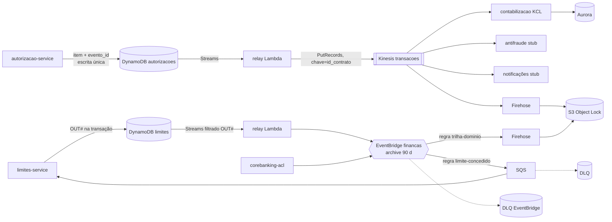

# Arquitetura orientada a eventos — EventBridge do jeito certo

## Regra de decisão

- **Síncrono** só quando o chamador precisa da resposta para responder: autorização → limites.
- **Evento** para todo fato consumado.
- **Canal por volume e roteamento:**
  - fluxo transacional (1 evento por autorização, até 5.000/s, particionado por contrato) → **Kinesis Data Streams**
  - integração entre domínios (baixo volume, roteamento por regra, vários consumidores heterogêneos) → **EventBridge**

## Por que não colocar tudo no EventBridge (validado na documentação AWS)

| Fato (sa-east-1) | Valor | Consequência |
|---|---|---|
| Quota padrão PutEvents | **600/s** (us-east-1: 10.000) | 5.000 eventos/s exigiria aumento de ~8× |
| Quota padrão de invocações de destino | **1.100/s** | 5.000 eventos × 4 destinos = 20.000/s |
| Destinos por regra | 5 (fixo) | fan-out amplo exige SNS/SQS adicional |
| Preço | US$ 1,00/milhão de eventos + US$ 0,69/milhão no Pipes | ~US$ 13 mil/mês só de barramento no volume assumido |
| Kinesis provisionado (8 shards, retenção 7 d, EFO) | ~US$ 0,7 mil/mês | replay de 7 dias por consumidor, consumidores independentes (ordem **não** garantida: ver Garantias) |

O PDF pede exatamente essa avaliação (§3.3: "Avaliar SQS/Kinesis/MSK para stream de alta volumetria e
ordenação por chave de partição"). Ordem estrita por contrato exigiria `PutRecord` serial por shard, sem
paralelismo no relay, e o PDF exige o contrário: consumidores tolerantes a reordenação. MSK foi descartado:
mesmas propriedades com mais operação (brokers,
versões, rebalanceamento) e custo mínimo maior para este volume.

## Fluxos

## Catálogo

| Evento (CloudEvents `type`) | Produtor | Canal | Consumidores |
|---|---|---|---|
| `…autorizacao.transacao-autorizada.v1` | autorização (outbox embutido) | Kinesis | contabilização, antifraude, notificações, trilha |
| `…autorizacao.transacao-recusada.v1` | autorização | Kinesis | antifraude, trilha |
| `…autorizacao.estorno-realizado.v1` | autorização | Kinesis | contabilização, notificações, trilha |
| `…corebanking.limite-concedido.v1` | ACL | EventBridge | limites (SQS), trilha |
| `…limites.limite-alterado.v1` | limites (outbox explícito) | EventBridge | trilha (e futuros consumidores por regra) |
| `…limites.operacao-revertida.v1` | limites | EventBridge | trilha |

Cada reserva **não** vira evento próprio: o saldo resultante já vai em `TransacaoAutorizada`. Isso evita
~3,9 bi eventos/mês. O diário de operações (Position Keeping) fica nos itens `OPERACAO#` (TTL 35 d) e na trilha S3.

## Garantias

| Garantia | Como |
|---|---|
| Sem dual-write | o evento é gravado na **mesma escrita** do agregado (atributos `evento_*` no item; item `OUT#` na transação do Limites) |
| At-least-once | Streams → relay com falha parcial (retoma da primeira falha); `maximum_record_age = -1`; falhas definitivas → SQS `outbox-relay-falhas` |
| Deduplicação | `id` do CloudEvent (= id do fato); inbox na contabilização |
| Ordem | **não garantida**: `PutRecords` não garante ordem (doc AWS) e o relay processa itens em paralelo. Cada consumidor é independente de ordem: a contabilização trata cada fato isoladamente (o estorno usa o próprio payload) e deduplica pelo `id` |
| Evolução de schema | JSON Schema por evento no Glue Schema Registry (FULL) + `ContratoDeEventosTest` no build — ver [visao-da-solucao.md](visao-da-solucao.md) §5 |
| Replay | Kinesis 7 dias; EventBridge archive 90 dias; trilha S3 (WORM) |
| Envenenamento | KCL: 3 tentativas → quarentena SQS, segue o shard; stubs: `bisect_batch_on_function_error` |
| Custo de filtragem | filtros nos event source mappings: registros descartados não invocam nem cobram a Lambda |

## Atualização pós-auditoria: ponte de compatibilidade EventBridge (ADR-040)

O fluxo contábil principal continua no **Kinesis**. Foi adicionada uma ponte opcional e
**desligada por padrão** via EventBridge Pipes, que filtra somente
`br.com.itau.financas.autorizacao.transacao-autorizada.v1`, envolve o CloudEvent em
`detail.event` (preservando o `event_id`) e publica na custom bus. Uma regra destina
esse fato a um tópico SNS e uma SQS de notificação, ambos com DLQs e retries relevantes.

**Não confundir IaC com execução:** a feature flag
`habilitar_eventbridge_transacoes` ainda exige validação de Terraform, quota EventBridge
no pico 5.000 TPS, leitores adicionais do Kinesis e orçamento. A SQS ainda não contém
um consumidor de notificação real. Consulte [fluxos atuais](diagramas/fluxos-atuais.md).

O prazo de retenção de DynamoDB Streams é 24h; conciliação diária e replay histórico
precisam ser testados. Após TTL, a recuperação da trilha S3 é **manual** e a trilha pode
não conter um evento que nunca chegou ao Kinesis (ADR-041).
