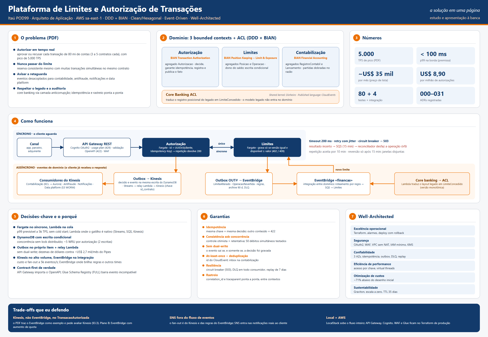
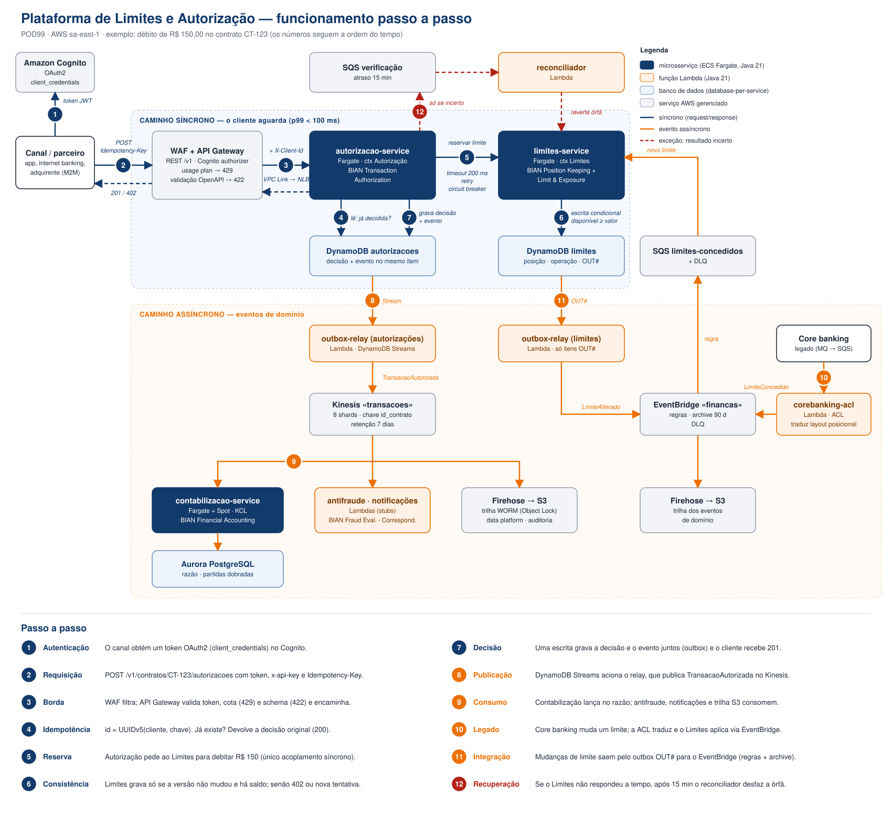

> **ATENÇÃO (migração 22/10/2026):** esta visão detalhada e seus PNGs descrevem o cenário histórico **ECS/Aurora**, e NÃO representam o desenho final. A versão vigente é [EKS Auto Mode + RDS PostgreSQL](visao-eks-rds.md), conforme [ADR-042](adr/042-eks-automode-rds-postgres.md). Os diagramas históricos permanecem por rastreabilidade, não para defesa da infraestrutura atual.

# Visão da Solução e Aderência ao Desafio

**Plataforma de Gestão de Limites e Autorização de Transações · Itaú Unibanco · POD99 — Nova Plataforma de Finanças**

| | |
|---|---|
| Objetivo deste documento | Explicar, em uma leitura, como a solução funciona e como cada requisito do desafio foi atendido |
| Público | Banca técnica da defesa e quem for ler o entregável pela primeira vez |
| Detalhamento | Cada seção aponta para o documento ou código que aprofunda o tema |
| Versão | 2.0 · 21/10/2026 |

---



> Roteiro de fala para a defesa: [roteiro-apresentacao.md](roteiro-apresentacao.md). Como rodar: [../COMO-RODAR.md](../COMO-RODAR.md).

## 1. Resumo executivo

- **O problema:** autorizar em tempo real transações de 80 milhões de contas (3 a 5 contratos cada), com pico de
  **5.000 TPS**, sem nunca aprovar acima do limite, mesmo com muitas transações simultâneas no mesmo contrato,
  e avisar os sistemas de retaguarda de forma desacoplada.
- **A solução:** três microsserviços alinhados a *bounded contexts* do DDD e a *Service Domains* do BIAN:
  **Autorização**, **Limites** e **Contabilização**. Uma camada anticorrupção isola o core banking legado.
- **O que é síncrono e o que é assíncrono:** só a reserva de limite (Autorização → Limites) é síncrona, porque o
  cliente precisa da resposta. Todo o resto é evento: contabilidade, antifraude, notificações, data platform e
  legado.
- **Como garantimos consistência:** escrita condicional no DynamoDB (sem lock distribuído), idempotência ponta a
  ponta pela `Idempotency-Key` e *outbox* (o evento é gravado na mesma escrita da decisão).
- **Custo estimado:** **~US$ 35 mil/mês** (preço de lista sa-east-1), cerca de **US$ 8,90 por milhão de
  autorizações**, 71% abaixo do desenho inicial ([custos.md](custos.md)).
- **Base:** AWS Well-Architected Framework (6 pilares + Financial Services Lens), validado na documentação
  oficial.

---

## 2. Como funciona — passo a passo



> Fonte editável do diagrama: [diagramas/gerar_fluxo_passo_a_passo.py](diagramas/gerar_fluxo_passo_a_passo.py).

### 2.1 Caminho síncrono — o cliente aguarda a resposta (passos 1 a 7)

Exemplo: débito de R$ 150,00 no contrato `CT-123`.

| # | O que acontece | Quem faz | Por que é seguro |
|---|---|---|---|
| **1** | O canal obtém um token OAuth2 (*client_credentials*) | Amazon Cognito | Autenticação máquina a máquina, sem senha de usuário |
| **2** | O canal envia `POST /v1/contratos/CT-123/autorizacoes` com token, `x-api-key` e `Idempotency-Key` | Canal | A chave identifica a intenção; repetir não duplica |
| **3** | O WAF filtra ataques; o API Gateway valida o token, aplica a cota do cliente (**429**) e o schema OpenAPI (**422**), e encaminha com `X-Client-Id` | WAF + API Gateway | Requisição inválida ou abusiva nem chega ao serviço |
| **4** | O serviço calcula `id = UUIDv5(cliente, Idempotency-Key)` e lê se essa autorização já existe. Se existir, devolve a decisão original (**200**). Mesma chave com outro conteúdo devolve **422** | autorizacao-service | O id é determinístico: a mesma chave sempre aponta para o mesmo registro |
| **5** | Pede ao Limites para debitar R$ 150 (timeout 200 ms, retentativa com *jitter*, *circuit breaker*). Circuito aberto devolve **503** (*fail-fast*) | autorizacao-service → limites-service | Único acoplamento síncrono; a operação é idempotente pelo mesmo id |
| **6** | Lê a posição do contrato e grava **somente se** a versão não mudou e `disponível ≥ valor`. Sem saldo devolve **402**; se outra transação mudou o saldo no meio, tenta de novo e, esgotadas as tentativas, devolve **409** | limites-service + DynamoDB | Controle otimista: duas transações nunca consomem o mesmo saldo |
| **7** | Uma única escrita grava a decisão **e** o evento (outbox) e o cliente recebe **201** com `id_autorizacao` e saldo reservado | autorizacao-service + DynamoDB | Não existe "gravou mas não publicou" (sem dual-write) |

### 2.2 Caminho assíncrono — eventos de domínio (passos 8 a 11)

| # | O que acontece | Canal | Garantia |
|---|---|---|---|
| **8** | O DynamoDB Streams entrega a escrita do passo 7 ao *outbox-relay*, que publica `TransacaoAutorizada` (CloudEvents) | Kinesis `transacoes`, chave `id_contrato` | Entrega *at-least-once*; replay de 7 dias; consumidores independentes de ordem |
| **9** | Os consumidores processam de forma independente: a **Contabilização** lança no razão (partidas dobradas, Aurora), **antifraude** e **notificações** reagem, **Firehose** grava a trilha imutável no S3 | Kinesis | Cada consumidor deduplica pelo `id` do evento; se um cair, os outros seguem |
| **10** | O core banking altera um limite; a **ACL** traduz o layout legado em `LimiteConcedido`; uma regra do EventBridge entrega numa fila SQS e o Limites aplica | EventBridge → SQS | O modelo do legado não entra no domínio; versão monotônica impede aplicar dado velho |
| **11** | Mudanças de limite saem pelo outbox explícito (`OUT#`) para o EventBridge, com regras, *archive* de 90 dias e DLQ | EventBridge `financas` | Roteamento por regra para consumidores futuros sem alterar o produtor |

### 2.3 Exceção — resultado incerto (passo 12)

Se o Limites não responder a tempo, a Autorização não sabe se o débito foi aplicado. Ela responde **503**. A própria operação persistida no **Limites** é capturada pelo **DynamoDB Streams**
e a Lambda `agendador-verificacao` a entrega à SQS com atraso de 15 minutos, **independentemente** da task
Autorização estar viva. A entrega é at-least-once e conta com DLQ; quando houver uma falha prolongada,
a conciliação diária por exportações DynamoDB/Athena/Aurora complementa a recuperação. O **reconciliador** confere e, se a operação ficou órfã
(debitada sem decisão gravada), **reverte** o débito.

O cliente pode retentar com a mesma `Idempotency-Key` por até **10 minutos**, e a reversão só acontece depois
de **15 minutos**. Como as duas janelas não se sobrepõem, uma retentativa nunca disputa com uma reversão
([concorrencia.md](concorrencia.md)).

### 2.4 Códigos de resposta

| HTTP | Situação | Quem produz |
|---|---|---|
| 201 | Aprovada | autorizacao-service |
| 200 | Repetição da mesma requisição (resultado original) | autorizacao-service |
| 402 | Limite insuficiente | limites-service (regra de domínio) |
| 409 | Conflito de concorrência persistente, ou retentativa depois da janela de 10 min | autorizacao-service |
| 422 | Payload inválido, regra de domínio violada ou mesma chave com outro conteúdo | API Gateway (schema) + serviço (domínio) |
| 429 | Cota ou taxa do cliente excedida | API Gateway (usage plan) |
| 503 | Limites indisponível; circuito aberto | autorizacao-service (Resilience4j), com `Retry-After` |

Todos os erros seguem a **RFC 7807** (`application/problem+json`) com `codigo` e `correlation_id`.

---

## 3. Componentes da solução

### 3.1 Microsserviços (ECS Fargate · Java 21 · Spring Boot · arquitetura hexagonal)

| Serviço | Responsabilidade | Banco (database-per-service) | Agregados | BIAN |
|---|---|---|---|---|
| **autorizacao-service** | Decidir aprovar ou recusar, garantir a idempotência, registrar a decisão e publicar o fato | DynamoDB `autorizacoes` | `Autorizacao` | Transaction Authorization |
| **limites-service** | Manter o saldo de cada contrato: débito, reserva, crédito, estorno e novos limites do legado | DynamoDB `limites` | `Posicao`, `Operacao` | Position Keeping + Limit & Exposure Management |
| **contabilizacao-service** | Transformar fatos em lançamentos contábeis de partidas dobradas | Aurora PostgreSQL | `RegistroContabil`, `Lancamento` | Financial Accounting |

### 3.2 Funções Lambda (Java 21 · ARM64)

| Função | Gatilho | Responsabilidade |
|---|---|---|
| **outbox-relay** | DynamoDB Streams | Publicar os eventos gravados: autorizações → Kinesis; limites → EventBridge |
| **corebanking-acl** | SQS (alimentada pelo MQ do legado) | Camada anticorrupção: traduzir o registro do legado em `LimiteConcedido` |
| **reconciliador** | SQS com atraso de 15 min | Reverter operações órfãs de resultados incertos |
| **consumidores-stub** | Kinesis | Simular antifraude (BIAN Fraud Evaluation) e notificações (BIAN Correspondence) |

### 3.3 Bibliotecas compartilhadas

| Biblioteca | Padrão DDD | Conteúdo |
|---|---|---|
| `kernel-compartilhado` | Shared Kernel (mínimo) | `Dinheiro`: o mesmo arredondamento em todos os contextos |
| `linguagem-publicada` | Published Language | Envelope CloudEvents e payloads dos 6 eventos, testados contra os JSON Schemas |

### 3.4 Por que estas fronteiras

| Pergunta | Resposta |
|---|---|
| Por que separar Autorização de Limites? | A autorização é a **decisão sobre uma requisição** (idempotência, auditoria, canal). O limite é o **saldo do contrato**, que também muda por estornos e pelo legado. No BIAN são *Service Domains* diferentes e evoluem por motivos diferentes. |
| Por que a Contabilização é separada e usa PostgreSQL? | Precisa de outro modelo (razão, partidas dobradas, SQL, integridade relacional) e aceita consistência eventual de segundos. Fica fora do caminho crítico: se cair, a autorização continua funcionando. |
| Por que uma ACL? | O layout posicional do core banking não pode contaminar o domínio. Trocar o legado afeta só a ACL. |
| Por que DynamoDB no caminho síncrono? | Acesso por chave a 5k TPS, sem failover de *writer*, escrita condicional nativa. A leitura é barata (~US$ 0,9 mil/mês). |

Detalhes: [dominio.md](dominio.md) (linguagem ubíqua, invariantes, SOLID com exemplos) e
[arquitetura.md](arquitetura.md).

---

## 4. Aderência ao desafio

Legenda: ✅ atendido · ⚠️ atendido com desvio consciente (justificado na seção 6) · ⏳ pendente antes da entrega

### 4.1 Caso de negócio e volumetria (PDF §2.1 e §2.2)

| Requisito | Como foi atendido | Evidência | Status |
|---|---|---|---|
| Autorização síncrona em tempo real | Fargate sem *cold start*; orçamento de latência p99 < 100 ms | [arquitetura.md](arquitetura.md) | ✅ |
| Reserva de limite consistente sob concorrência | Escrita condicional (`versao` + `disponível ≥ valor`) com retentativa; teste com 50 débitos simultâneos no mesmo contrato | [concorrencia.md](concorrencia.md), `AplicarOperacaoServiceTest` | ✅ |
| Eventos de domínio (autorizada, limite alterado, estorno) | `TransacaoAutorizada`, `TransacaoRecusada`, `EstornoRealizado`, `LimiteAlterado`, `LimiteConcedido`, `OperacaoRevertida` | [eventos.md](eventos.md), `contracts/schemas` | ✅ |
| Picos previsíveis e imprevisíveis | Auto scaling por CPU, ação agendada no início do mês, *warm throughput* no DynamoDB, *resharding* do Kinesis | [arquitetura.md](arquitetura.md) | ✅ |
| Integração com legado via ACL | Lambda `corebanking-acl` com tradutor do layout posicional | `funcoes/corebanking-acl` | ✅ |
| Auditoria, rastreabilidade e idempotência | Trilha S3 com Object Lock (WORM); `correlation_id` e `traceparent` ponta a ponta; idempotência em toda operação mutante | `modulos/eventos`, `CorrelationIdFilter` | ✅ |
| 80 milhões de contas / 5.000 TPS | DynamoDB particionado por contrato; Kinesis com 8 shards; dimensionamento e custo calculados | [custos.md](custos.md) | ✅ no desenho · ⏳ teste de carga (`tests/k6`) não executado |

### 4.2 Contrato de API (PDF §2.3)

| Requisito | Como foi atendido | Evidência | Status |
|---|---|---|---|
| `POST /v1/contratos/{id_contrato}/autorizacoes` com os campos do PDF | Implementado exatamente com os campos e tipos pedidos | `contracts/openapi/autorizacoes-v1.yaml` | ✅ |
| `Idempotency-Key` em toda operação mutante | `id = UUIDv5(cliente, chave)` + impressão digital SHA-256 do payload | `AutorizacaoId`, `ImpressaoDigital` | ✅ |
| Códigos 201/200/402/409/422/429/503 | Todos mapeados (tabela 2.4) | `ProblemDetailsHandler`, `modulos/api` | ✅ |
| Versionamento e política de depreciação | Major no path; breaking change vira `/v2` com convivência mínima de 6 meses e headers `Deprecation`/`Sunset` (onde fica cada versão: [§5.6](#56-versionamento-dos-contratos-onde-fica-cada-versão)) | OpenAPI (`info.description`) | ✅ |
| Erros RFC 7807 com código, mensagem e correlação | `Problemas.de(...)` inclui `codigo` e `correlation_id` | `adapters/in/web` | ✅ |
| OpenAPI 3.x contract-first | OpenAPI 3.0.3 é a fonte: o API Gateway é **criado por importação do contrato**; oasdiff barra breaking change no CI | `contracts/openapi`, `modulos/openapi-api-gateway`, [§5.7](#57-produto-da-aws-para-contratos-de-api-rest) | ✅ |

### 4.3 Contrato de evento (PDF §2.4)

| Requisito | Como foi atendido | Evidência | Status |
|---|---|---|---|
| Campos do `TransacaoAutorizada` v1 | Todos presentes, nos atributos padrão do CloudEvents (tabela abaixo) | `transacao-autorizada-v1.json` | ✅ |
| Publicado em **Amazon EventBridge** | Publicado em **Kinesis**; o EventBridge fica com os eventos de integração | ADR 028 | ⚠️ |
| Imutável, nome no passado, CloudEvents | CloudEvents 1.0; nomes no passado; produzido só pelo outbox | `linguagem-publicada` | ✅ |
| `event_id` único para deduplicação | `id` do CloudEvent = id do fato | `ExtratorDeAutorizacoes` | ✅ |
| `correlation_id` não nulo; `trace_id` nulo permitido | `correlationid` obrigatório nos 6 schemas; sem correlação recebida, o evento usa o próprio `id` (raiz da cadeia); `traceparent` opcional | `CodecDeEventos`, `ContratoDeEventosTest` | ✅ |
| Modelar schema, roteamento e evolução | JSON Schema por evento, AsyncAPI com canais e consumidores, roteamento por canal, Glue Schema Registry com compatibilidade `FULL` | [seção 5](#5-governança-de-eventos-schema-roteamento-e-evolução) | ✅ |
| Consumidores idempotentes e tolerantes a reordenação | Inbox `ON CONFLICT DO NOTHING` na contabilização; consumidores não dependem de ordem entre contratos | `JdbcRegistroContabilRepository` | ✅ |

Correspondência entre os campos do PDF e o envelope CloudEvents:

| Campo do PDF | Onde está no evento |
|---|---|
| `event_id` | `id` |
| `event_type` | `type` (`br.com.itau.financas.autorizacao.transacao-autorizada.v1`) |
| `event_version` | sufixo do `type` + `dataschema` |
| `occurred_at` | `time` (UTC) |
| `correlation_id` | extensão `correlationid` |
| `trace_id` (W3C) | extensão `traceparent` |
| `id_autorizacao`, `id_contrato`, `valor`, `saldo_reservado` | `data` |

### 4.4 Requisitos técnicos (PDF §3)

| Requisito | Como foi atendido | Evidência | Status |
|---|---|---|---|
| **SOLID** explícito e justificado | Um exemplo real no código por princípio | [dominio.md](dominio.md) §SOLID | ✅ |
| **Clean Code** | Linguagem ubíqua em português, funções coesas, erros por tipo de exceção, testes legíveis | código + testes | ✅ |
| **Hexagonal** com inversão para frameworks e AWS SDK | `domain` → `application` (ports) → `adapters` → `config`; ArchUnit quebra o build se o núcleo depender de Spring ou AWS | `ArquiteturaTest` (3 serviços) | ✅ |
| **DDD**: contextos, agregados, invariantes, linguagem ubíqua | 3 contextos + ACL; agregados com invariantes no construtor e nos métodos | [dominio.md](dominio.md) | ✅ |
| **CQRS, Repository, Domain Events** (usar ou não) | Repository e Domain Events: sim. CQRS: só na leitura analítica (S3/Athena), com justificativa | [dominio.md](dominio.md) §Padrões táticos | ✅ |
| Fronteiras de serviço = bounded contexts | Limites, Autorização, Contabilização (os do exemplo do PDF) | `servicos/` | ✅ |
| Compute justificado frente a latência e throughput | Fargate no síncrono; Lambda na cola por evento; EKS descartado; Lambda no síncrono avaliado e descartado | ADRs 002, 022, 023 | ✅ |
| Database-per-service | DynamoDB (Autorização), DynamoDB (Limites), Aurora PostgreSQL (Contabilização) | `modulos/dados` | ✅ |
| EventBridge (regras), SNS e SQS (fan-out) | EventBridge com regras, archive e DLQ; SQS para filas e DLQs; o fan-out de alto volume é feito pelos consumidores do Kinesis. SNS só nos alarmes | `modulos/eventos` | ⚠️ |
| Avaliar SQS × Kinesis × MSK | Comparação com quotas e preços oficiais; Kinesis escolhido; MSK descartado | [eventos.md](eventos.md), ADR 028 | ✅ |
| API Gateway com autorização | REST API + Cognito authorizer (OAuth2) + API key | `modulos/api` | ✅ |
| Rate limiting, throttling, usage plans e quotas | Usage plan por cliente com taxa, rajada e cota; resposta 429 em RFC 7807 | `modulos/api` | ✅ |
| API Gateway × Service Mesh × BFF | Gateway na borda; sem mesh (App Mesh descontinuado), leste-oeste via ECS Service Connect; BFF só se houver canais com necessidades distintas | ADR 009 | ✅ |
| **Well-Architected** | Cada pilar mapeado para o que foi implementado | [arquitetura.md](arquitetura.md) §Well-Architected | ✅ |

### 4.5 Entregáveis (PDF §5)

| Entregável | Situação | Status |
|---|---|---|
| Código | 9 módulos Maven; `mvn install` com 80 testes passando; 4 testes de integração do DynamoDB real (`-Pintegracao`, Testcontainers) | ✅ (integração não executada nesta máquina: sem Docker) |
| IaC | Terraform com 8 módulos; `terraform validate` ok nos ambientes `prod` e `local`; `terraform test` do módulo de contrato (4 cenários) | ✅ (sem `plan/apply` em conta AWS) |
| Diagramas | Passo a passo (este documento), C4 e sequência ([arquitetura.md](arquitetura.md)), eventos, pirâmide BIAN → DDD | ✅ |
| ADRs | Decisões 000–030, com as substituídas marcadas | [adr/README.md](adr/README.md) ✅ |
| Demonstração local com Docker | `local/subir.sh` + `local/demo.sh` + `local/derrubar.sh`, revisados para Linux, macOS e Windows; guia em `COMO-RODAR.md` | ⏳ ainda não executada (Docker indisponível na máquina de desenvolvimento) |
| Arquivo ZIP | — | ⏳ gerar ao final |

---

## 5. Governança de eventos: schema, roteamento e evolução

O PDF (§2.4) pede: "o candidato deve modelar o schema do evento, a estratégia de roteamento e a evolução de
schema". Esta seção mostra onde cada uma dessas coisas é feita.

### 5.1 Quatro peças, cada uma com um papel

O CloudEvents **não** é o único contrato. Ele é o envelope. O conteúdo é definido por JSON Schema, e o AsyncAPI
documenta quem publica e quem consome. Todas as peças leem os **mesmos arquivos**.

| Peça | Papel | Analogia | Onde está |
|---|---|---|---|
| **CloudEvents 1.0** | Envelope padrão: `id`, `source`, `type`, `time`, `subject`, `dataschema` e as extensões `correlationid`, `traceparent`, `partitionkey`. Todo evento tem essa forma | o "envelope da carta" | `bibliotecas/linguagem-publicada` (`CloudEvent`, `CodecDeEventos`) |
| **JSON Schema (Draft-07)** | Conteúdo de cada evento: campos, tipos, obrigatórios, formato do dinheiro (`"150.00"` como string). Um arquivo por evento e versão | a "carta" | `contracts/schemas/eventos/*.json` (6 eventos) |
| **AsyncAPI 3.0** | Catálogo: canais (Kinesis, EventBridge), quem publica, quem consome e qual mensagem passa em cada canal. Referencia os JSON Schemas, sem duplicá-los | o "OpenAPI dos eventos" | `contracts/asyncapi/financas-eventos.yaml` |
| **AWS Glue Schema Registry** | Registro central em runtime: guarda as versões de cada schema e **recusa** uma versão nova incompatível | o "cartório" | `infra/terraform/modulos/eventos` (registra cada arquivo de `contracts/schemas/eventos`) |

Os 6 eventos modelados:

| Evento | Contexto produtor | Canal | Consumidores |
|---|---|---|---|
| `TransacaoAutorizada` | Autorização | Kinesis | contabilização, antifraude, notificações, data platform |
| `TransacaoRecusada` | Autorização | Kinesis | antifraude, data platform |
| `EstornoRealizado` | Autorização | Kinesis | contabilização, notificações, data platform |
| `LimiteConcedido` | Core Banking ACL | EventBridge | limites, trilha |
| `LimiteAlterado` | Limites | EventBridge | trilha e consumidores futuros (por regra) |
| `OperacaoRevertida` | Limites | EventBridge | trilha |

### 5.2 Onde a governança acontece (do PR à produção)

```
 1. Desenvolvedor altera contracts/schemas/eventos/<evento>-v1.json        (pull request revisável)
 2. mvn install → ContratoDeEventosTest valida que o código publica          (falha o build se divergir)
    exatamente o que o schema descreve
 3. terraform plan → mostra a nova versão do schema                          (revisão no PR)
 4. terraform apply → Glue Schema Registry registra a versão nova            (recusa se incompatível)
 5. Consumidores consultam o registry ou o AsyncAPI para saber o contrato    (descoberta)
```

Uma decisão consciente: a validação acontece **no build e no deploy**, não a cada evento publicado. Todos os
produtores usam a mesma biblioteca (`linguagem-publicada`), que é testada contra os schemas. Validar 5.000
eventos/s em runtime custaria CPU e latência sem achar nada que o build já não tenha achado.

### 5.3 Por que o Glue Schema Registry, e não o EventBridge Schema Registry

A AWS tem dois registros de schema, com propósitos diferentes (documentação oficial):

| | AWS Glue Schema Registry | Amazon EventBridge Schema Registry |
|---|---|---|
| Foco | **Governança e evolução**: "discover, control, and evolve data stream schemas" | **Descoberta e produtividade**: infere schemas dos eventos do barramento e gera *code bindings* para a IDE |
| Regras de compatibilidade | **8 modos** (NONE, DISABLED, BACKWARD, BACKWARD_ALL, FORWARD, FORWARD_ALL, FULL, FULL_ALL); versão incompatível é recusada | A documentação não descreve verificação de compatibilidade entre versões |
| Formatos | Avro, **JSON Schema (Draft-04, 06 e 07)**, Protobuf | OpenAPI 3 e JSON Schema Draft-04 |
| Integrações | **Kinesis Data Streams**, MSK/Kafka, Lambda, Flink | EventBridge |

Como a solução usa **Kinesis e EventBridge**, e o PDF pede evolução "validada por um schema registry", o Glue é o
único que cobre os dois canais e aplica regra de compatibilidade. O EventBridge Schema Registry pode ser ligado
no barramento `financas`, em ambiente de desenvolvimento, só para descoberta. Ele complementa o Glue, não o
substitui.

### 5.4 Regras de evolução

O registry usa o modo **`FULL`**: uma versão nova só é aceita se consumidores antigos leem eventos novos **e**
consumidores novos leem eventos antigos. Na prática, só campos **opcionais** entram ou saem.

Por que não `BACKWARD`? Pela documentação do Glue, `BACKWARD` garante que consumidores *atualizados* leiam dados
antigos e permite **remover campos**. Num barramento com vários consumidores de outros times, que não atualizam
juntos, isso quebraria quem ainda usa o campo removido.

| Mudança | Exemplo | Como fazer |
|---|---|---|
| Adicionar campo opcional | `canal_origem` em `TransacaoAutorizada` | Mesmo arquivo `-v1.json`; o registry cria a versão 2 do schema; o `type` continua `.v1` |
| Tornar obrigatório, renomear, mudar tipo, remover campo obrigatório | `valor` passar de string para número | **Breaking change**: novo `type` `...transacao-autorizada.v2` e novo arquivo `-v2.json`; o produtor publica v1 e v2 em paralelo até todos os consumidores migrarem; depois desliga a v1 |
| Consumidor recebe campo que não conhece | — | Ignora: `FAIL_ON_UNKNOWN_PROPERTIES = false` no codec e `additionalProperties: true` no schema |

Os schemas ainda não foram publicados em produção. Por isso, tornar `correlationid` obrigatório agora (21/10)
não é breaking change: é a definição da v1.

### 5.5 Estratégia de roteamento

| Canal | Como o evento chega ao consumidor certo |
|---|---|
| **Kinesis `transacoes`** | Todos os eventos de transação vão para o mesmo stream, particionados por `id_contrato`. Cada consumidor lê o stream inteiro e filtra pelo `type` do CloudEvent; nas Lambdas o filtro fica no *event source mapping* e o registro descartado nem invoca a função |
| **EventBridge `financas`** | Cada regra casa `source` e `detail-type` (= `type` do CloudEvent) e entrega no destino. Exemplo real: a regra `limite-concedido` casa `source = itau.financas.corebanking-acl` e entrega na fila SQS do Limites. Consumidor novo = regra nova, sem mexer no produtor |

### 5.6 Versionamento dos contratos: onde fica cada versão

**Regra principal:** a **fonte da verdade é o repositório** (pasta `contracts/`, versionada no git do time e
revisada por pull request). Cada tipo de contrato tem um **produto gerenciado da AWS** que guarda a versão em
execução, criado pelo Terraform a partir desses mesmos arquivos. Ninguém edita contrato direto no console.

```
 contracts/  (repositório = fonte da verdade)          CI (barra breaking)            AWS (versão em execução)
 ├─ openapi/autorizacoes-v1.yaml ───────────────────▶ verificar-contrato-api.sh ──▶ API Gateway REST: a API é
 │   └─ schemas/autorizacao-request.json               (oasdiff)                      IMPORTADA do contrato
 │                                                                                    (rotas, validação → 422,
 │                                                                                     Cognito, API key)
 ├─ openapi/limites-interno-v1.yaml                    revisão do PR                  (API interna, via Service
 │                                                                                     Connect, sem API Gateway)
 ├─ schemas/eventos/*-v1.json ──────────────────────▶ ContratoDeEventosTest ──────▶ Glue Schema Registry
 │                                                                                    "financas" (regra FULL)
 └─ asyncapi/financas-eventos.yaml                     (catálogo; aponta para os JSON Schemas)
```

| Contrato | Fonte da verdade | Produto AWS (versão em execução) | Como a versão aparece | Quem barra uma mudança errada |
|---|---|---|---|---|
| **API pública** de autorização | `contracts/openapi/autorizacoes-v1.yaml` (OpenAPI 3.0.3) | **API Gateway REST**, criado por **importação do próprio contrato** (`body` = OpenAPI + extensões AWS); cada mudança gera um deployment novo com a versão na descrição | **Major no path** (`/v1`); minor e patch em `info.version` (`1.0.0`) | **oasdiff** no CI (`contracts/verificar-contrato-api.sh`); request validator do API Gateway (422) |
| **API interna** do Limites | `contracts/openapi/limites-interno-v1.yaml` | Não passa pelo API Gateway (leste-oeste via Service Connect) | Major no path (`/v1/contratos/{id}/operacoes`) | Revisão do PR; testes dos dois serviços |
| **Eventos** (6) | `contracts/schemas/eventos/<evento>-v1.json` | **Glue Schema Registry** `financas`: schema `transacao-autorizada-v1` com versões numeradas | **Major no `type`** (`...transacao-autorizada.v1`); minor = número da versão no Glue; `dataschema` aponta para o schema | `ContratoDeEventosTest` no build; Glue recusa versão incompatível (`FULL`) |

Exemplo de vida de cada contrato:

| Momento | API `/v1/contratos/{id}/autorizacoes` | Evento `TransacaoAutorizada` |
|---|---|---|
| Hoje | `info.version 1.0.0` | `type ...v1` · Glue: versão 1 |
| Adiciono um campo **opcional** (ex.: `canal_origem`) | `1.1.0`; mesma rota `/v1`; oasdiff aprova; clientes atuais não percebem | `type ...v1` continua; Glue registra a versão 2 (aceita pelo `FULL`) |
| Preciso de uma mudança **breaking** (ex.: renomear `valor`) | oasdiff **barra** a mudança no `-v1`. Ela entra como nova rota `/v2` (arquivo `-v2.yaml`) no mesmo API Gateway; `/v1` passa a responder com `Deprecation` e `Sunset`; as duas convivem por no mínimo 6 meses | Novo arquivo `-v2.json` e novo `type ...v2`; o produtor publica v1 e v2 em paralelo até todos migrarem |
| Fim da convivência | `/v1` é removida | O produtor para de publicar a v1 |

### 5.7 Produto da AWS para contratos de API REST

A AWS **não tem um registry separado de OpenAPI** como o Glue é para eventos. O papel é do **próprio API
Gateway**, com três recursos (documentação oficial):

| Recurso do API Gateway | O que faz | Uso nesta solução |
|---|---|---|
| **Importação de OpenAPI** (2.0 e 3.0) | Cria a API a partir do arquivo: rotas, parâmetros, models, validação, autorização e integração (extensões `x-amazon-apigateway-*`) | **Implementado**: módulo `infra/terraform/modulos/openapi-api-gateway` lê o contrato e gera o corpo importado; testado com `terraform test` (4 cenários) |
| **Documentation versions** | Guarda versões da documentação, associa cada uma a um stage e exporta um snapshot em OpenAPI | Recomendado ao publicar a primeira mudança de versão |
| **API Gateway portals** | Portal web gerenciado para consumidores: agrupa APIs em "produtos", publica documentação, compartilha entre contas AWS, acesso via Cognito | Recomendado para os canais consumidores; criado por console, CLI ou SDK (a documentação não cita Terraform), por isso fica fora do IaC |

O que o API Gateway **não** faz é barrar uma mudança incompatível: ele aceita qualquer definição nova. Essa
proteção fica no pipeline, com o **oasdiff** (open source), que compara o contrato do PR com o publicado e falha
se houver breaking change. É o mesmo papel da regra `FULL` do Glue nos eventos.

Como a importação funciona, na prática:

| Do contrato (sem mudança) | Acrescentado pelo módulo (só AWS) | Retirado na tradução (só documentação) |
|---|---|---|
| rota `/v1/contratos/{id_contrato}/autorizacoes`, parâmetros obrigatórios (`Idempotency-Key`, `id_contrato`), schema do request, escopo OAuth2 `financas/autorizacoes.write` | Cognito authorizer, API key (usage plan), validador de corpo e parâmetros, integração VPC Link → NLB com `X-Client-Id` do token, respostas 422/429 em Problem Details | exemplos, schemas de resposta (a integração `HTTP_PROXY` repassa a resposta do serviço) |

Ajustes feitos no contrato para a importação (21/10), validados na documentação da AWS: versão **OpenAPI 3.1.0 →
3.0.3** (o API Gateway REST importa só 2.0 e 3.0; o contrato não usava nada exclusivo do 3.1) e `valor`
**`exclusiveMinimum` → `minimum: 0.01`** (não suportado pelo API Gateway; equivalente para decimal(18,2) > 0).

Outros pontos:

- **Stage do API Gateway não é versão.** O stage se chama `api` (ponto de publicação); a versão está no path.
  Assim `/v1` e `/v2` convivem no mesmo stage, com o mesmo WAF, Cognito e usage plans. Corrigido em 21/10: o
  stage se chamava `v1`, o que geraria a URL `/v1/v1/contratos`.
- **Os headers `Deprecation` e `Sunset` são política documentada** no OpenAPI. Ainda não há código, porque ainda
  não existe uma `/v2` para anunciar.
- **Não executado:** a importação não foi aplicada em conta AWS (sem `terraform apply`), e o oasdiff não rodou
  nesta máquina (não há binário nem Docker ativo). O que está verificado é a tradução, pelo `terraform test`, e o
  `terraform validate` dos dois ambientes.

---

## 6. Desvios conscientes e trade-offs

O PDF pede ao candidato que "proponha alternativas e discuta quando a solução escolhida não é ideal". Estes são os
pontos em que a solução se afasta do exemplo do enunciado, e o motivo de cada um.

### 6.1 `TransacaoAutorizada` no Kinesis, não no EventBridge

**Foi proposital** (ADR 028). E não é contra o PDF. O EventBridge aparece no §2.4, cujo título é
"Contrato de Evento — **Exemplo**", e o mesmo parágrafo diz que o candidato deve modelar "a estratégia de
roteamento". Já o §3.3 pede para "**avaliar** SQS / Kinesis / MSK para stream de **alta volumetria**". A
avaliação foi feita e o resultado está abaixo.

**Por que o EventBridge é uma boa escolha em geral (e por que provavelmente aparece no exemplo):** é o padrão
da AWS para eventos de domínio entre times. Oferece roteamento por regra (consumidor novo sem mexer no
produtor), barramentos entre contas AWS, archive e replay, DLQ e quase nenhuma operação. É por isso que ele
**continua no desenho** para os eventos de integração (`LimiteConcedido`, `LimiteAlterado`, `OperacaoRevertida`).

**Por que não no `TransacaoAutorizada`**, com os argumentos em ordem de peso:

| # | Argumento | EventBridge | Kinesis | Peso |
|---|---|---|---|---|
| 1 | **Custo no volume assumido** (3,9 bi eventos/mês) | ~US$ 13 mil/mês: US$ 1/milhão para publicar + entrega em filas por consumidor | ~US$ 0,7 mil/mês | **Forte** |
| 2 | **Fan-out em alto volume** | 5.000 eventos/s × 4 consumidores = 20.000 entregas/s, contra quota padrão de 1.100 invocações/s | Cada consumidor lê o stream no seu ritmo, sem multiplicar entregas | **Forte** |
| 3 | **Replay por consumidor** | Archive re-envia para o barramento (todos recebem de novo) | Cada consumidor relê até 7 dias a partir do seu próprio ponto | Médio |
| 4 | Quota de publicação em sa-east-1 | 600 PutEvents/s (padrão) | 1.000 registros/s por shard; 8 shards = 8.000/s | **Fraco**: a quota é ajustável e a AWS pode aumentá-la |
| 5 | Ordem por contrato | Não garantida | **Também não garantida** (`PutRecords` e relay paralelo) | **Irrelevante**: o PDF exige consumidores tolerantes a reordenação, e os nossos são (C02) |

**Plano B, se a governança corporativa exigir que todo evento de domínio passe pelo barramento central:**
publicar `TransacaoAutorizada` no EventBridge, com aumento de quota solicitado à AWS. O contrato CloudEvent é o
mesmo, então os consumidores não mudam. O custo é cerca de US$ 11 mil/mês a mais ([custos.md](custos.md)) e o
replay passa a ser pelo archive.

**Resumo para a banca:** Kinesis para o fluxo de alto volume dentro da plataforma; EventBridge para integração
entre domínios e times.

### 6.2 SNS fora do fluxo de eventos

O §3.3 cita SNS e SQS para "fan-out e desacoplamento". Na solução:

- o **fan-out de alto volume** é feito pelos consumidores do Kinesis, que leem o mesmo stream de forma independente;
- o **fan-out de baixo volume** é feito pelas regras do EventBridge (até 5 destinos por regra, e quantas regras
  forem necessárias);
- o **desacoplamento** é feito pelo SQS, com DLQ, entre o EventBridge e o Limites.

Pôr SNS no meio seria mais um salto, com custo e sem ganho. O SNS aparece nos alarmes operacionais e é a escolha
natural quando surgir um consumidor que precise de *push* para muitos assinantes heterogêneos, como e-mail ou SMS
nas notificações reais ao cliente (hoje um stub).

### 6.3 Outros trade-offs relevantes

| Decisão | Ganho | Custo aceito | ADR |
|---|---|---|---|
| Relay Lambda em vez de EventBridge Pipes | ~US$ 2,7 mil/mês economizados | Código pequeno a manter (testado) | 026 |
| Id determinístico + reconciliação posterior | 1 escrita por autorização no caminho feliz | Limite órfão é investigado após ~15 min, podendo demorar mais com falhas/retentativas | 027 |
| DynamoDB Streams como transporte do outbox | Sem dual-write, gatilho nativo | Retenção de 24 h: relay parado por mais de 1 dia perde eventos. Mitigado por alarme de `IteratorAge` e reconciliação diária pela trilha S3 | 026 |
| DR regional ativo-passivo | Consistência do limite preservada | RTO regional maior; Global Tables multi-região forte (MRSC) não está disponível em sa-east-1 | 010 |

---

## 7. Pendências antes da entrega

| Item | Por que importa | Situação |
|---|---|---|
| Executar a demo local (`local/subir.sh` + `local/demo.sh`) | O PDF exige demonstração na defesa | Depende do Docker Desktop ativo |
| Rodar os testes de integração do DynamoDB real (`mvn verify -Pintegracao`) | Provam expressões condicionais, transações e concorrência no DynamoDB de verdade | Implementado; ignorado sem Docker, executar na máquina de teste |
| Propagar `correlation_id` da Autorização para o Limites e de `LimiteConcedido` para `LimiteAlterado` | Rastreio ponta a ponta entre contextos | ✅ Feito em 21/10 (header `X-Correlation-Id` + MDC; teste `EventosParaCloudEventTest`) |
| Teste de carga com k6 | Confirmar o número de tasks e a latência p99 | Script pronto em `tests/k6`, feito para a AWS; não executado |
| Rodar o oasdiff e aplicar a importação do OpenAPI numa conta AWS | Hoje só a tradução está provada (`terraform test`) | Pendente (sem conta AWS por decisão) |
| Gerar o ZIP do entregável | Formato pedido no PDF | Ao final |

---

## 8. Onde encontrar cada coisa

| Quero entender… | Leia |
|---|---|
| A arquitetura completa (C4, sequência, compute, Well-Architected, DR) | [arquitetura.md](arquitetura.md) |
| O domínio (BIAN, contextos, agregados, invariantes, SOLID) | [dominio.md](dominio.md) |
| Os eventos (canais, catálogo, garantias) | [eventos.md](eventos.md) |
| Como a concorrência é tratada (cenários C1 a C11) | [concorrencia.md](concorrencia.md) |
| Os custos e como foram calculados | [custos.md](custos.md) · [custos/calcular_custos.py](custos/calcular_custos.py) |
| As decisões e alternativas | [adr/README.md](adr/README.md) |
| Os contratos | `../contracts/` (OpenAPI, AsyncAPI, JSON Schemas) |
| A infraestrutura | `../infra/terraform/` |
| Como rodar | [../README.md](../README.md) · `../local/LEIAME.md` |


### Atualização de auditoria — 22/10/2026

- **C01/C03:** agendador de verificações derivado de Streams do Limites, SQS atrasada e conciliação diária
  com exportações DynamoDB/Athena/Aurora já existem. **Não há garantia absoluta de correção em 15 minutos**.
- **C05:** modelo AmountBlock agora distingue RESERVA→CAPTURA/LIBERACAO e expiração, com regras de domínio.
- **C06:** eventos de tipo desconhecido não são descartados pela contabilização; devem ir à quarentena/DLQ.
- **C04:** ponte Kinesis→EventBridge Pipes `TransacaoAutorizada` v1 e fan-out SNS→SQS agora são
  configuráveis por Terraform, **desligados por padrão** até validação de quota/custo (ADR-040).
- **C03 remanescente:** republicação automática baseada no item atual não recupera evento expirado pelo TTL;
  a conciliação falha em vez de encerrar silenciosamente e há runbook de replay a partir da trilha S3 WORM.
- Resultados de Maven/LocalStack/Terraform após estas alterações **ainda não foram executados**.
