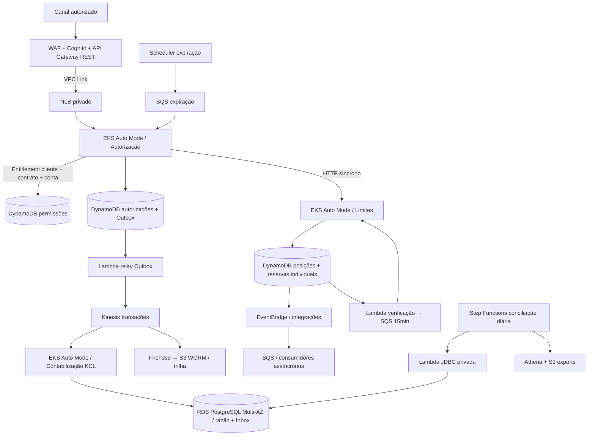

# Solução-alvo do Itaú — EKS Auto Mode + RDS PostgreSQL

**Data:** 22/10/2026. Esta é a visão **vigente**. O pôster PNG e documentos anteriores
sobre ECS/Aurora representam a proposta **histórica substituída** e não devem ser usados
para defender a infraestrutura atual.

## Topologia lógica

**Detalhe importante:** somente Autorização → Limites é síncrono;
DynamoDB faz transações apenas dentro do mesmo contexto. Entre os dois serviços,
há mini-saga com compensação e verificação independente por Streams.

## Tecnologias e aderência ao PDF

| Requisito/decisão | Implementação escolhida | Defesa técnica |
|---|---|---|
| Compute | **EKS Auto Mode** 3 AZ, Deployments, PDB, HPA, ClusterIP, Pod Identity | Orquestração Kubernetes e governança; maior custo operacional comparado ao ECS |
| Contabilização | **RDS PostgreSQL convencional Multi-AZ** | PostgreSQL familiar, ACID e SQL; standby síncrono oferece HA, NÃO read scaling por si só |
| Autorização/Limites | DynamoDB por serviço | Atualizações condicionais no agregado, reserva por id e idempotência |
| Eventos de alto volume | DynamoDB Streams→Lambda→Kinesis | Desacopla contabilidade, tolera reordenação, escala leitores |
| Integração por regras | EventBridge, SQS, SNS | Expiração, eventos do core/limites, DLQs e fan-out |
| API | API Gateway REST + Cognito + WAF + private VPC Link/NLB | Contract-first, quota, auditoria, defesa em profundidade |
| IAM | EKS Pod Identity por SA | Cada bounded context assume role específica; IAM detalhado ainda precisa de validação determinística |
| Contabilidade | Inbox + partidas dobradas transacionais | Consumo at-least-once com deduplication por CloudEvent ID |
| Recuperação | Reconciliador SQS/Step Functions/Athena/Lambda JDBC | Lacunas de publicação/reversão monitoradas; replay >TTL é manual |

## RDS PostgreSQL — impacto da escolha em escalabilidade

O PDF demanda pico de **5.000 TPS** e o modelo financeiro anterior usava
**1.500 TPS médios** como hipótese, não como requisito do Itaú.
A 1.500 TPS contínuos por 30 dias são **3,888 bilhões de autorizações**;
se todas forem fatos contabilizáveis, 1 Inbox + 1 registro + 2 lançamentos
representam **15,552 bilhões de linhas por mês**. Não há evidência de que
uma instância RDS PostgreSQL writer e 500 GB deem conta desse volume.

Antes de produção, o banco deverá ter **estratégia explícita de particionamento,
retenção e arquivamento para S3**, índices otimizados, capacidade de writer/WAL e
RDS read replicas se houver consultas intensivas. Multi-AZ protege disponibilidade,
mas não elimina gargalo de gravação. Kinesis absorve variações temporárias desde
que a taxa sustentável do consumidor alcance a média e seu atraso permaneça abaixo
da retenção (7 dias no desenho atual).

## Segurança — lacunas explícitas

- Projeção de entitlement existe, mas falta fonte corporativa segura para
  alimentar/revogar permissões (ADR-043).
- O backend ainda depende do header validado/injetado no API Gateway; falta JWT
  resource-server ou mTLS end-to-end para impedir bypass interno.
- HTTPS na API pública; leste-oeste ainda HTTP no cluster e requer plano de TLS/identidade.
- NLB e Kubernetes API privados. EKS privado exige VPN/DirectConnect para `kubectl`.
- Password do RDS deve vir do Secrets Manager via external controller; o YAML
  não inclui segredo e **não é implantável antes do provisionamento deste Secret**.
- Aplicação/migração atualmente planejam usuário administrador RDS, contrariando least privilege;
  separar usuário SQL de aplicação e papel de migração é pendência **P0 antes de produção**.

## O que é código e o que depende de infraestrutura externa

- **Implementado no código/IaC:** EKS Terraform, RDS PostgreSQL Multi-AZ,
  manifests, HTTP endpoints e lógica financeira.
- **Não executado nem validado:** Terraform plan, criação EKS, associar TG,
  autenticação Pod Identity, conexão JDBC, compilação Maven/IT depois da migração,
  LocalStack E2E, metas 5k TPS e RTO/RPO.
- **Outras dependências para produção:** rollout de imagens no ECR, observabilidade
  Kubernetes de workloads (CloudWatch/Prometheus), Secrets rotacionáveis,
  DR regional, escala horizontal de nodes e estratégia de retenção do razão.

## Evidências
- [ADR-042 — migração EKS/RDS](adr/042-eks-automode-rds-postgres.md)
- [ADR-043 — entitlement](adr/043-entitlement-cliente-contrato.md)
- [ADR-044 — reserva individual](adr/044-posicao-bloqueio-por-reserva.md)
- [Guia EKS](../k8s/README.md)
- [Status e checklist](STATUS-EKS-RDS.md)
