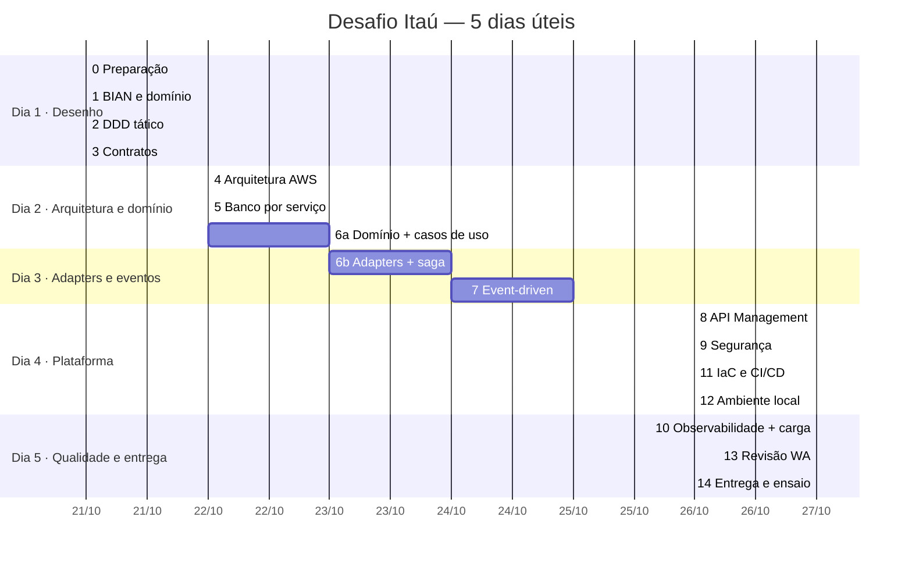
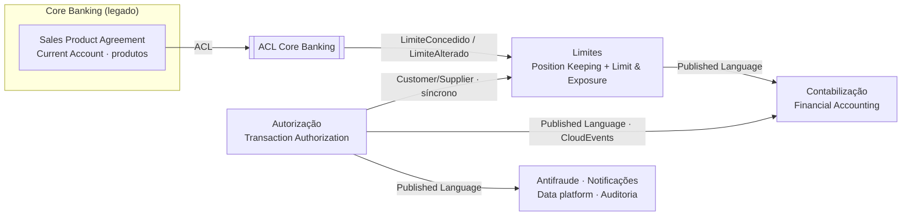
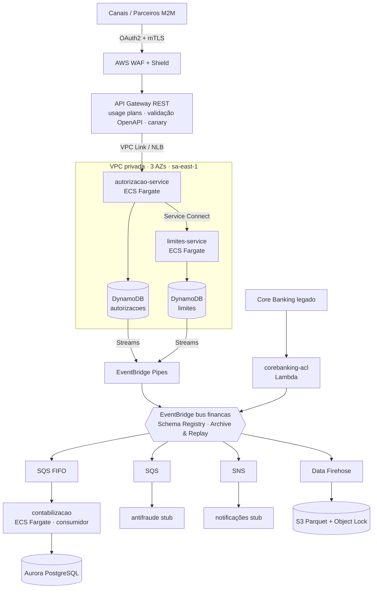
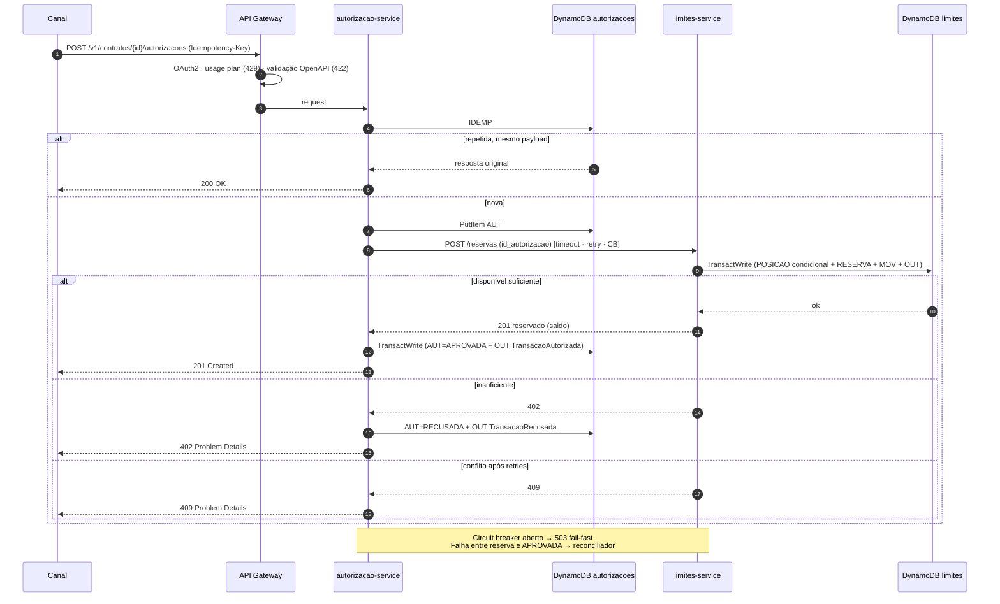
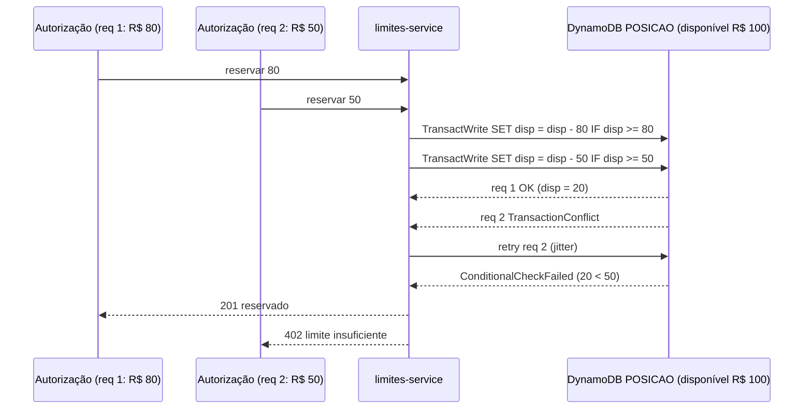
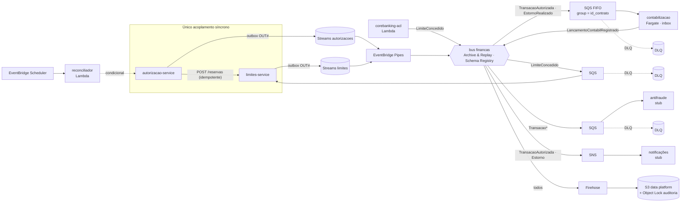

# Plano de Implantação — Desafio Itaú POD99 (Plataforma de Limites e Autorização)

> Passo a passo para construir **tudo o que o PDF pede**, na ordem: BIAN → DDD → contratos → arquitetura AWS → banco → microsserviços → eventos → API → segurança → observabilidade → IaC → demo → entrega e defesa.
> Base: decisões e validações registradas em [MEMORIA.md](MEMORIA.md). **Este é um plano histórico de 21/10, NÃO um status de execução.** O código foi implementado e auditado posteriormente: ver [`../apresentacao-itau/docs/adr/README.md`](../apresentacao-itau/docs/adr/README.md) e [`../apresentacao-itau/docs/STATUS-FASES.md`](../apresentacao-itau/docs/STATUS-FASES.md). Itens antigos e cronograma abaixo são preservados para rastreabilidade.

---

## 0. Visão geral

```mermaid
flowchart LR
    F0[0. Preparação<br/>decisões pendentes] --> F1[1. BIAN e domínio<br/>event storming]
    F1 --> F2[2. DDD tático<br/>agregados e invariantes]
    F2 --> F3[3. Contratos<br/>OpenAPI · AsyncAPI · CloudEvents]
    F3 --> F4[4. Arquitetura AWS<br/>C4 · WA · capacidade]
    F4 --> F5[5. Banco por serviço<br/>DynamoDB · Aurora]
    F5 --> F6[6. Microsserviços<br/>hexagonal · SOLID]
    F6 --> F7[7. Event-driven<br/>outbox · EventBridge · SQS]
    F7 --> F8[8. API Management<br/>API GW · Cognito · usage plans]
    F8 --> F9[9. Segurança e compliance]
    F9 --> F10[10. Observabilidade<br/>e resiliência]
    F10 --> F11[11. IaC e CI/CD]
    F11 --> F12[12. Ambiente local<br/>e roteiro de demo]
    F12 --> F13[13. Revisão Well-Architected]
    F13 --> F14[14. Entrega ZIP<br/>e defesa]
```



### Cronograma (5 dias úteis)



> O cronograma considera o início em 21/10 e pula o fim de semana. Ajuste para a data em que o PDF foi recebido.

---

## Fase 0 — Preparação (decisões que destravam tudo)

**Objetivo:** fechar as decisões pendentes antes de desenhar e codar.

| # | Passo | Decisão recomendada | Registro |
|---|---|---|---|
| 0.1 | Linguagem e framework | ✅ **Java 21**: Spring Boot 3 (Fargate); Java puro + Powertools + SnapStart (Lambda) | ADR 019, 022 |
| 0.2 | IaC | ✅ **AWS CDK em Java** → CloudFormation + cdk-nag (decidido; o PDF não exige ferramenta) | ADR 020 |
| 0.3 | NFRs que o PDF não define | p99 < 100 ms na borda; 99,95% de disponibilidade; RPO ≈ 0 / RTO < 15 min (AZ) | MEMORIA §1 |
| 0.4 | Semântica de `tipo_operacao` | ver tabela da Fase 2 | ADR 021 |
| 0.5 | Região e DR | sa-east-1 primária (3 AZs); região de DR a confirmar (residência de dados) | ADR 010 |
| 0.6 | Formato dos ADRs | MADR (contexto, decisão, alternativas, consequências, pilar WA) | — |
| 0.7 | Estrutura do repositório | ver abaixo | — |

```
itau-limites-autorizacao/
├─ docs/
│  ├─ MEMORIA.md · PLANO-IMPLANTACAO.md
│  ├─ adr/                    ← 000…0NN em MADR
│  ├─ dominio/                ← BIAN, event storming, glossário, context map
│  ├─ diagramas/              ← C4, AWS, torre LEGO, sequência
│  └─ well-architected/       ← auto-revisão por pilar + FSI Lens
├─ contracts/
│  ├─ openapi/                ← autorizacoes-v1.yaml (externo), limites-v1.yaml (interno)
│  ├─ asyncapi/               ← financas-events.yaml
│  └─ schemas/                ← JSON Schema dos CloudEvents (Glue Registry)
├─ services/
│  ├─ autorizacao-service/    ← domain · application · adapters
│  ├─ limites-service/
│  ├─ contabilizacao-service/
│  └─ corebanking-acl/
├─ consumers/                 ← stubs antifraude, notificações
├─ infra/                     ← app AWS CDK (Java): uma stack por domínio (rede, dados, compute, eventos, api, observabilidade, segurança)
├─ local/                     ← docker-compose, LocalStack init, Keycloak realm, seeds
└─ tests/                     ← k6 (carga), cenários de demo
```

**Pronto quando:** 0.1 a 0.5 respondidas e registradas.

---

## Fase 1 — BIAN e domínio (DDD estratégico)

**PDF atendido:** §3.1 DDD (bounded contexts, linguagem ubíqua); §3.2 fronteiras alinhadas a bounded contexts.

| # | Passo | Como | Entregável |
|---|---|---|---|
| 1.1 | Recorte do BIAN | Usar a hierarquia **validada** (MEMORIA §3.2): 5 áreas → 10 domínios → 4 SDs núcleo + 6 de legado + 4 consumidores | `docs/dominio/bian.md` |
| 1.2 | Justificativa SD a SD | Copiar §3.3 e §3.4 da memória (usados e descartados, com motivo) | `docs/dominio/bian.md` |
| 1.3 | Event storming | Eventos (laranja), comandos (azul), agregados (amarelo), políticas (lilás), sistemas externos (rosa) | `docs/dominio/event-storming.md` + diagrama |
| 1.4 | Linguagem ubíqua | Glossário PT-BR ↔ BIAN (MEMORIA §3.6) | `docs/dominio/glossario.md` |
| 1.5 | Subdomínios | Core: Autorização, Limites · Supporting: Contabilização · Integração: ACL | `docs/dominio/subdominios.md` |
| 1.6 | Bounded contexts e context map | Customer/Supplier, Published Language, ACL | diagrama de context map + ADR 001, 011, 018 |

Eventos do event storming (em ordem):

```
ContratoSincronizado → LimiteConcedido → AutorizacaoSolicitada → LimiteReservado | LimiteInsuficiente
→ TransacaoAutorizada | TransacaoRecusada → LancamentoContabilRegistrado
→ EstornoSolicitado → ReservaLiberada → EstornoRealizado → LancamentoContabilEstornado
```



**Pronto quando:** torre LEGO, context map e glossário revisados; ADRs 001, 011 e 018 escritos.

---

## Fase 2 — DDD tático

**PDF atendido:** §3.1 DDD (agregados, invariantes) e padrões táticos (CQRS, Repository, Domain Events).

| # | Passo | Conteúdo |
|---|---|---|
| 2.1 | Agregado `Autorizacao` (CR Interactive Transaction Assessment) | Estados: PENDENTE → APROVADA / RECUSADA → ESTORNADA. Invariantes: só APROVADA pode ser estornada; estorno ≤ valor aprovado; transições idempotentes |
| 2.2 | Agregado `LimiteContrato` (CR Financial Position Log) | `limite_concedido`, `disponivel`, `versao`, reservas (`Reserva` = Amount Block), movimentos (`Movimento` = Financial Transaction Capture). Invariante: **`disponivel >= 0`**, e reservar duas vezes a mesma `id_autorizacao` não tem efeito |
| 2.3 | Agregado `RegistroContabil` (CR Financial Booking Log) | `Lancamento` em partidas dobradas: Σ débitos = Σ créditos por fato contábil |
| 2.4 | Value Objects | `Dinheiro` (BigDecimal escala 2, > 0, moeda ISO 4217), `ContratoId`, `ContaId`, `AutorizacaoId`, `IdempotencyKey`, `TipoOperacao` |
| 2.5 | Domain Events | `TransacaoAutorizada`, `TransacaoRecusada`, `LimiteReservado`, `ReservaLiberada`, `LimiteAlterado`, `EstornoRealizado`, todos no passado e imutáveis |
| 2.6 | Regras → HTTP | domínio recusa por saldo → **402**; conflito de versão após retries → **409**; regra de domínio violada → **422** |
| 2.7 | Padrões táticos (ADR) | Repository: **sim**. Domain Events: **sim** (outbox). CQRS: **não** na escrita; **sim** na leitura (extrato/posição via eventos) |

Semântica proposta de `tipo_operacao` (validar, ADR 021):

| Tipo | Efeito no limite | Evento |
|---|---|---|
| DEBITO | reserva e consome `valor` (disponível ↓) | TransacaoAutorizada |
| RESERVA | bloqueia `valor` sem consumir (pré-autorização), com expiração | LimiteReservado |
| CREDITO | devolve limite (pagamento de fatura/parcela): disponível ↑ até `limite_concedido` | LimiteAlterado |
| ESTORNO | desfaz uma autorização anterior (exige referência em `metadata`) | EstornoRealizado |

**Pronto quando:** máquina de estados e invariantes descritas; ADR de padrões táticos escrito.

---

## Fase 3 — Contratos (contract-first)

**PDF atendido:** §2.3 contrato de API; §2.4 contrato de evento; §3.4 contract-first, versionamento e depreciação.

| # | Passo | Detalhe |
|---|---|---|
| 3.1 | OpenAPI 3.1 externo | `POST /v1/contratos/{id_contrato}/autorizacoes`: header `Idempotency-Key` (UUID, obrigatório), schema do request (PDF §2.3), respostas 201/200/402/409/422/429/503 |
| 3.2 | OpenAPI interno | `limites-service`: `POST /v1/contratos/{id}/reservas` (idempotente por `id_autorizacao`), `DELETE …/reservas/{id}`, `GET …/limite` |
| 3.3 | Erros RFC 7807 | `application/problem+json` com `type`, `title`, `status`, `detail`, `instance`, `codigo`, `correlation_id`; catálogo de `type` por erro |
| 3.4 | Política de versão | major no path (`/v1`); mudança aditiva não muda a versão; breaking change → `/v2` com convivência mínima (ex.: 6 meses), headers `Deprecation` e `Sunset` |
| 3.5 | AsyncAPI 3 | canais por evento, CloudEvents 1.0, `type` = `br.com.itau.financas.<contexto>.<evento>.v1` |
| 3.6 | JSON Schema dos eventos | dinheiro como string decimal; `traceparent`, `correlationid`, `partitionkey`; registrar no **Glue Schema Registry** com compatibilidade **BACKWARD** |
| 3.7 | Governança | lint (Spectral) + detecção de breaking change (oasdiff) no CI; a request validation do API Gateway nasce do mesmo OpenAPI |

**Pronto quando:** contratos validados por lint e revisados contra o PDF campo a campo.

---

## Fase 4 — Arquitetura de solução AWS

**PDF atendido:** §3.2 runtime de compute justificado; §1 Well-Architected; entregável "desenho de arquitetura".

| # | Passo | Detalhe |
|---|---|---|
| 4.1 | C4 nível 1 (contexto) | canais → plataforma → core banking, contabilidade, antifraude, data platform |
| 4.2 | C4 nível 2 (containers) | ver diagrama abaixo |
| 4.3 | Diagrama AWS | ícones oficiais (MEMORIA §2) |
| 4.4 | Compute (ADR 002, 022, 023) | Híbrido com regra: Fargate Graviton no síncrono e no consumo de alto volume (contabilização); Lambda na cola por evento (ACL, reconciliador, stubs); EKS descartado. Matriz de custo em MEMORIA §4.8 |
| 4.5 | Capacidade | 5k TPS × ~3 escritas = **~15k WCU** (autorização) + ~5k WCU (limites); Fargate: ~N tasks por serviço com folga de 2× no pico (validar no teste de carga); **quotas** do API Gateway e do DynamoDB conferidas e pedidas com antecedência |
| 4.6 | Orçamento de latência (p99 < 100 ms) | API GW + WAF ~10 ms · autorização ~15 ms · chamada a limites ~10 ms · DynamoDB 2 × ~5 ms · folga |
| 4.7 | Mapa WA por pilar | MEMORIA §4.1 a §4.6 viram `docs/well-architected/` |



**Pronto quando:** C4 1 e 2, diagrama AWS e cálculo de capacidade revisados.

---

## Fase 5 — Banco por serviço (database-per-service)

**PDF atendido:** §3.2 persistência por serviço; §2.1 consistência sob concorrência, idempotência e auditoria.

### 5.1 DynamoDB `autorizacoes` (single-table)
| Item | PK | SK | Atributos | Observação |
|---|---|---|---|---|
| Autorização | `AUT#<id>` | `AUT` | estado, valor, contrato, versão, timestamps | condição de transição de estado |
| Idempotência | `IDEMP#<key>` | `IDEMP` | hash do payload, resposta original, TTL 48 h | `attribute_not_exists(PK)` |
| Outbox | `OUT#<event_id>` | `OUT` | CloudEvent completo, TTL 7 d | filtrado pelo Pipes |
| GSI1 | `CONTRATO#<id>` | `occurred_at` | — | consulta por contrato |

### 5.2 DynamoDB `limites`
| Item | PK | SK | Atributos | Observação |
|---|---|---|---|---|
| Posição | `CONTRATO#<id>` | `POSICAO` | limite_concedido, disponível, versão | `ConditionExpression: disponivel >= :valor AND versao = :v` |
| Reserva | `CONTRATO#<id>` | `RESERVA#<id_autorizacao>` | valor, estado, expira_em | idempotente por `id_autorizacao` |
| Movimento | `CONTRATO#<id>` | `MOV#<ts>#<id>` | tipo, valor | diário imutável (Position Keeping) |
| Outbox | `OUT#<event_id>` | `OUT` | CloudEvent | — |

Reserva atômica: `TransactWriteItems` = atualizar POSICAO (condicional) + criar RESERVA + MOV + OUT.
Partição por contrato: 320M contratos com tráfego distribuído, então partição quente é improvável. Monitorar com **Contributor Insights**.

### 5.3 Aurora PostgreSQL `contabilizacao`
- `lancamento(id, fato_id, conta_contabil, natureza D/C, valor numeric(18,2), data_contabil)` com a regra Σ D = Σ C por `fato_id` (constraint/trigger ou validação transacional)
- `evento_processado(event_id PK)`: deduplicação do consumidor idempotente
- `plano_de_contas` (Financial Accounting: chart of accounts)

### 5.4 Transversal
PITR + deletion protection (DynamoDB), Multi-AZ + backups (Aurora), KMS CMK por domínio, AWS Backup, retenção definida.

**Pronto quando:** modelo de acesso → chave revisado para cada endpoint e evento (ADRs 003, 008, 013).

---

## Fase 6 — Microsserviços (Hexagonal, SOLID, Clean Code)

**PDF atendido:** §3.1 SOLID, Clean Code, Hexagonal; §2.3 idempotência; §2.3 503/circuit breaker.

### 6.1 Estrutura por serviço
```
<servico>/
├─ domain/        ← Java puro: agregados, VOs, eventos, exceções de domínio (sem Spring, sem AWS SDK)
├─ application/   ← casos de uso + ports (in: AutorizarTransacao; out: LimitesPort, AutorizacaoRepository, EventOutbox)
└─ adapters/
   ├─ in/web      ← controller REST, mapper DTO, ProblemDetails handler
   ├─ out/dynamo  ← repositórios DynamoDB
   ├─ out/http    ← cliente de limites (Resilience4j)
   └─ config      ← wiring Spring (único lugar que conhece todos)
```

### 6.2 SOLID explícito (onde cada princípio aparece)
| Princípio | Onde |
|---|---|
| **S**RP | um caso de uso por classe (`AutorizarTransacao`, `EstornarAutorizacao`); o controller só traduz HTTP |
| **O**CP | `RegraDeOperacao` por `tipo_operacao` (Strategy): um tipo novo é uma classe nova, sem `switch` |
| **L**SP | todos os adapters de `AutorizacaoRepository` (DynamoDB, in-memory dos testes) respeitam o mesmo contrato de idempotência |
| **I**SP | ports pequenos: `ReservarLimitePort`, `LiberarReservaPort`, em vez de um `LimitesClient` gigante |
| **D**IP | o domínio e a aplicação dependem de ports; AWS SDK e Spring só nos adapters. **ArchUnit** garante isso no build |

### 6.3 Fluxo do caminho síncrono (mini-saga)


### 6.4 Demais passos
| # | Passo |
|---|---|
| 6.4.1 | Domínio + testes unitários (TDD nas invariantes: concorrência, idempotência, estados) |
| 6.4.2 | Casos de uso + ports + testes com adapters in-memory |
| 6.4.3 | Adapters DynamoDB + testes de integração (Testcontainers + LocalStack) |
| 6.4.4 | Resilience4j: timeout (ex.: 50 ms), retry com jitter só em erro idempotente, circuit breaker → 503, bulkhead |
| 6.4.5 | Reconciliador: EventBridge Scheduler → Lambda varre PENDENTE expiradas; confirma ou libera a reserva |
| 6.4.6 | `corebanking-acl`: traduz o contrato do legado (mock) para `LimiteConcedido` |
| 6.4.7 | `contabilizacao-service` (Fargate, Spring Cloud AWS SQS listener): consome SQS FIFO, deduplica por `event_id`, grava partidas dobradas em lote; auto scaling pela profundidade da fila (ADR 023) |

### 6.5 Concorrência (onde e como)

| Ponto | Mecanismo | Resposta |
|---|---|---|
| Reserva no mesmo contrato (C1/C2) | update atômico com `disponivel >= :v` em `TransactWriteItems`; `TransactionConflict` → retry com jitter | 402 / 409 |
| Reserva repetida (C3) | `attribute_not_exists` em `RESERVA#<id_autorizacao>` | devolve a original |
| Mesma Idempotency-Key em paralelo (C4) | `attribute_not_exists` em `IDEMP#` + estado EM_PROCESSAMENTO | 409 / 200 / 422 |
| Aprovação × reconciliador (C5) | `estado = PENDENTE` como condição | uma transição vence |
| Estornos simultâneos (C6) | `valor_estornado + :v <= valor` | 422 se exceder |
| Limite do legado fora de ordem (C7) | delta + `versao_origem < :nova` | ignora o antigo |
| Evento duplicado na contabilização (C8) | inbox `ON CONFLICT DO NOTHING` na mesma transação + FIFO por contrato | 1 lançamento |



Detalhes, limites físicos e testes: [MEMORIA.md §3.7](MEMORIA.md).

**Pronto quando:** testes verdes, ArchUnit verde, cobertura das invariantes.

---

## Fase 7 — Arquitetura event-driven

**PDF atendido:** §2.4 (CloudEvents, at-least-once, schema registry, consumidores idempotentes); §3.3 EventBridge, SNS, SQS e avaliação de SQS/Kinesis/MSK.

| # | Passo | Detalhe |
|---|---|---|
| 7.1 | Outbox → Pipes | Streams das duas tabelas → Pipes (filtro `OUT#`) → bus `financas` |
| 7.2 | Regras de roteamento | por `detail-type`: contabilidade (SQS FIFO, `MessageGroupId = id_contrato`), antifraude (SQS), notificações (SNS), data platform (Firehose → S3) |
| 7.3 | DLQ em todo alvo | redrive documentado; alarme de profundidade |
| 7.4 | Archive & Replay | arquivo do bus com retenção definida; runbook de replay |
| 7.5 | Consumidores idempotentes | tabela `evento_processado` / condição por `event_id`; tolerância a reordenação (ignorar versão mais antiga) |
| 7.6 | Schema registry | validação no CI e no publisher; evolução BACKWARD |
| 7.7 | ADR SQS vs Kinesis vs MSK | hoje: EventBridge + SQS (ordenação por contrato basta). Migrar para Kinesis/MSK se precisar de replay longo, ordenação por partição com alto throughput ou fan-out com dezenas de consumidores em streaming |

### 7.0 Mapa de eventos (o que vamos implementar)



Catálogo completo de eventos, consumidores e escopo: [MEMORIA.md §3.8](MEMORIA.md). Concorrência (C1–C11): [MEMORIA.md §3.7](MEMORIA.md).

**Pronto quando:** um evento sai do outbox e chega aos 4 destinos; DLQ e replay demonstráveis.

---

## Fase 8 — API Management

**PDF atendido:** §3.4 API Gateway, autorização, rate limiting, usage plans, quotas, contract-first, depreciação, Gateway vs Mesh vs BFF.

| # | Passo | Detalhe |
|---|---|---|
| 8.1 | API Gateway REST | importa o OpenAPI; request validator; VPC Link → NLB |
| 8.2 | Autorização | Cognito (OAuth2 `client_credentials`), scopes `autorizacoes:write` / `autorizacoes:read`; mTLS para parceiros |
| 8.3 | Usage plans | por plano (ex.: Bronze/Prata/Ouro), com rate, burst e quota por cliente → 429 |
| 8.4 | Canary + estágios | `v1` estável com canary de 10% para releases |
| 8.5 | Depreciação | headers `Deprecation`/`Sunset`, comunicação, métrica de uso por versão |
| 8.6 | ADR Gateway vs Mesh vs BFF | gateway na borda; leste-oeste via Service Connect (App Mesh descontinuado); BFF só com canais distintos (app vs parceiros) |

---

## Fase 9 — Segurança e compliance

**PDF atendido:** §2.1 auditoria, rastreabilidade, conformidade regulatória.

| # | Passo |
|---|---|
| 9.1 | IAM least privilege por task/função; sem credenciais estáticas; Secrets Manager com rotação |
| 9.2 | VPC privada + VPC endpoints (DynamoDB, EventBridge, SQS, ECR, Logs, KMS, STS) |
| 9.3 | KMS CMK por domínio; TLS 1.2+ |
| 9.4 | WAF managed rules + rate-based rules; Shield |
| 9.5 | Trilha de auditoria: CloudTrail + eventos → S3 **Object Lock** (compliance mode), que é o Archive Services do BIAN |
| 9.6 | Detecção: GuardDuty, Security Hub, Inspector (ECR), Config |
| 9.7 | LGPD: minimizar PII nos eventos; controle por coluna no data lake (Lake Formation) |

---

## Fase 10 — Observabilidade e resiliência

**PDF atendido:** §1 sistemas resilientes (Well-Architected); §2.1 rastreabilidade (correlation_id/trace).

| # | Passo |
|---|---|
| 10.1 | ADOT (OpenTelemetry) → X-Ray; `traceparent` do HTTP propagado para o CloudEvent |
| 10.2 | Logs estruturados com `correlation_id`, `id_autorizacao`, `id_contrato` |
| 10.3 | CloudWatch Application Signals: SLOs (disponibilidade e p99 da autorização) e alarmes por burn rate |
| 10.4 | Dashboards: TPS, 2xx/4xx/5xx por código, 402 vs 409, profundidade de DLQ, idade do outbox |
| 10.5 | Teste de carga k6: rampa até 5k TPS, pico de 2×, cenário de contenção (mesmo contrato) |
| 10.6 | Experimentos FIS: matar tasks, latência no DynamoDB, perda de AZ → validar 503 fail-fast e recuperação |
| 10.7 | Escala: target tracking + scheduled scaling (início de mês) + warm throughput (Black Friday) |

> A carga local prova a **correção** (idempotência, concorrência). A escala de 5k TPS só se prova em conta AWS.

---

## Fase 11 — IaC e CI/CD

**PDF atendido:** entregável "IaC".

| # | Passo |
|---|---|
| 11.1 | Stacks/módulos: rede, dados, compute, eventos, API, observabilidade, segurança |
| 11.2 | Mesmas stacks CDK local (`cdklocal` → LocalStack) e na AWS (`cdk deploy`); `cdk diff` em todo PR; **cdk-nag** (AwsSolutions) quebra o build em violação de segurança |
| 11.3 | Pipeline: lint de contratos → build → unitários + ArchUnit → integração (Testcontainers/LocalStack) → scan (deps, imagem) → deploy blue/green (ECS) / CodeDeploy (Lambda) → smoke test |
| 11.4 | Tags de custo por domínio e serviço; Budgets |

---

## Fase 12 — Ambiente local e roteiro de demo

**PDF atendido:** §5 "Demonstrar execução da solução (local com docker ou em conta AWS)".

| # | Passo |
|---|---|
| 12.1 | `docker-compose`: LocalStack (DynamoDB, Streams, EventBridge, SQS, SNS, Lambda, Firehose, S3, API GW REST), Postgres, Keycloak, Jaeger, os 4 serviços |
| 12.2 | Script de bootstrap: tabelas, bus, regras, filas, seed de contratos/limites |
| 12.3 | Plano B se o Pipes falhar no LocalStack: Lambda lendo o Stream (mesmo contrato de evento) |
| 12.4 | Conferir a licença/auth token do LocalStack |

Roteiro de demo (cerca de 10 min, cada passo prova um requisito):

| Passo | Ação | Resultado esperado | Requisito |
|---|---|---|---|
| 1 | Autorizar R$ 100 | **201** + `saldo_reservado` | autorização síncrona |
| 2 | Repetir com a mesma `Idempotency-Key` | **200**, mesma resposta | idempotência |
| 3 | Mesma chave, payload diferente | **422** | idempotência segura |
| 4 | Valor acima do disponível | **402** Problem Details | regra de negócio |
| 5 | 50 requisições paralelas no mesmo contrato | soma aprovada ≤ limite; parte **409**/402 | concorrência |
| 6 | Payload inválido | **422** | validação |
| 7 | Estourar o usage plan | **429** | throttling |
| 8 | Derrubar o `limites-service` | **503** fail-fast (circuit breaker) | resiliência |
| 9 | Mostrar o evento no bus e nos 4 destinos | contabilidade (Postgres), antifraude, notificação, S3 | event-driven |
| 10 | Replay do arquivo | consumidor não duplica lançamento | consumidor idempotente |
| 11 | Trace no Jaeger | ponta a ponta com `correlation_id` | rastreabilidade |

---

## Fase 13 — Revisão Well-Architected

| # | Passo |
|---|---|
| 13.1 | Auto-revisão por pilar (as perguntas do WA + FSI Lens) em `docs/well-architected/`: riscos altos/médios e plano de melhoria |
| 13.2 | *Opcional, só se você quiser usar uma conta AWS:* registrar a workload no WA Tool e exportar o relatório. Sem conta, a auto-revisão documental cumpre o papel |

---

## Fase 14 — Entrega e defesa

**PDF atendido:** §5 (ZIP com código, IaC, diagramas, ADRs; apresentação de 20 min + 40 min de perguntas + demo).

| # | Passo |
|---|---|
| 14.1 | ZIP: `docs/` (ADRs, diagramas, BIAN, WA), `contracts/`, `services/`, `consumers/`, `infra/`, `local/`, `tests/`, README com "como rodar em 3 comandos" |
| 14.2 | Índice de ADRs (000–0NN) com status e pilar |
| 14.3 | Apresentação (20 min): problema e NFRs (2) → torre BIAN → DDD (4) → arquitetura AWS e WA (5) → decisões-chave e trade-offs (5) → demo (4) |
| 14.4 | Preparação das perguntas: MEMORIA §9 + "o que eu faria diferente com mais tempo" |
| 14.5 | Ensaio da demo duas vezes, com o plano B (vídeo gravado) se o ambiente falhar |

---

## Matriz de rastreabilidade (PDF → fase → artefato)

| Requisito do PDF | Fase | Artefato |
|---|---|---|
| SOLID explícito e justificado | 6 | código + `docs/adr` + tabela §6.2 |
| Clean Code, testes legíveis | 6 | testes unitários e de integração |
| Clean/Hexagonal, DIP para frameworks e AWS SDK | 6 | módulos `domain/application/adapters` + ArchUnit |
| DDD: bounded contexts, agregados, invariantes, linguagem ubíqua | 1, 2 | `docs/dominio/*`, torre LEGO, glossário |
| CQRS, Repository, Domain Events (usar ou não) | 2 | ADR de padrões táticos |
| Fronteiras de serviço por bounded context | 1, 6 | context map + 4 serviços |
| Compute justificado por latência e throughput | 4 | ADR 002 + orçamento de latência |
| Database-per-service | 5 | modelos DynamoDB/Aurora + ADRs 003, 008, 013 |
| EventBridge + SNS + SQS | 7 | IaC de eventos + demo passo 9 |
| Avaliar SQS / Kinesis / MSK | 7 | ADR 7.7 |
| API Gateway + Cognito/OAuth2 | 8 | IaC da API + ADR 007 |
| Rate limiting, usage plans, quotas | 8 | usage plans + demo passo 7 |
| Contract-first OpenAPI, versionamento, depreciação | 3, 8 | `contracts/openapi` + política §3.4 |
| Gateway vs Service Mesh vs BFF | 8 | ADR 009 |
| Idempotency-Key | 2, 5, 6 | item `IDEMP#` + demo passos 2 e 3 |
| Erros RFC 7807 | 3, 6 | catálogo de erros + handler |
| 402 / 409 / 422 / 429 / 503 | 2, 6, 8 | demo passos 4 a 8 |
| Evento CloudEvents, `event_id` único, at-least-once | 3, 7 | AsyncAPI + schemas + consumidor idempotente |
| Schema registry, evolução retrocompatível | 3, 7 | Glue Schema Registry BACKWARD |
| Consumidores idempotentes, tolerantes a reordenação | 7 | `evento_processado` + demo passo 10 |
| Consistência sob concorrência na reserva | 5, 6 | conditional write + demo passo 5 |
| Picos previsíveis e imprevisíveis | 10 | scheduled scaling + warm throughput + teste k6 |
| ACL com o legado | 6 | `corebanking-acl` |
| Auditoria e rastreabilidade | 9, 10 | Object Lock + CloudTrail + tracing |
| Well-Architected | 4, 13 | mapa por pilar + auto-revisão |
| ZIP: código, IaC, diagramas, ADRs | 14 | estrutura §14.1 |
| Demo local com docker ou AWS | 12 | docker-compose + roteiro |

---

## Riscos do plano

| Risco | Impacto | Mitigação |
|---|---|---|
| LocalStack sem suporte completo ao Pipes ou exigindo licença | demo de eventos | plano B (Lambda no Stream); confirmar licença no Dia 1 |
| 5 dias é pouco para os 4 serviços completos | escopo | priorizar autorização + limites + outbox + contabilização; ACL e stubs mínimos |
| Não provar 5k TPS localmente | pergunta na defesa | cálculo de capacidade + explicar que a escala só se prova na AWS (ou rodar k6 em conta, se houver) |
| Semântica de CREDITO/ESTORNO ambígua no PDF | regra errada | declarar a premissa no ADR 021 |
| Região de DR indefinida | ADR 010 incompleto | apresentar as opções e o trade-off, e declarar a premissa |
